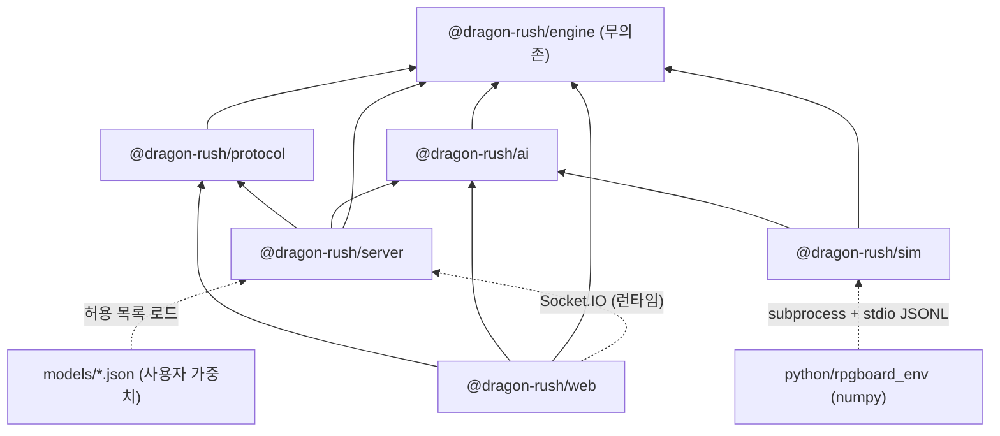
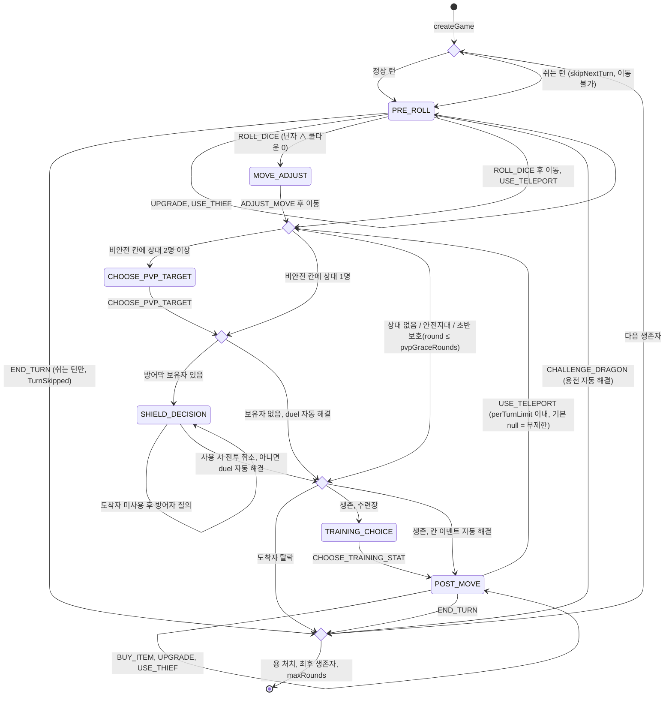
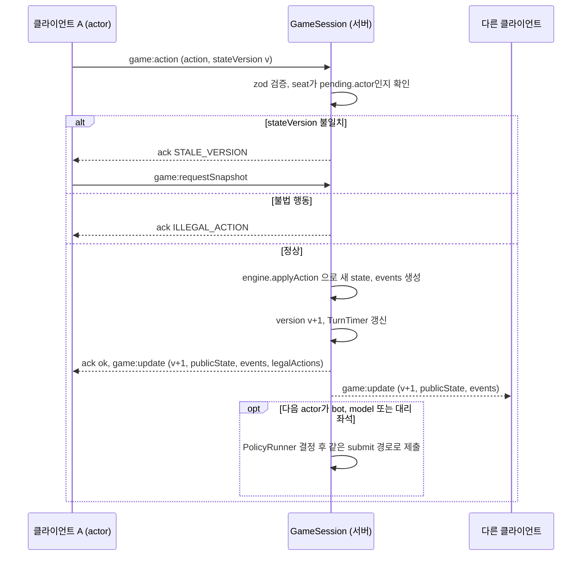

# 아키텍처 설계서 — 드래곤 러쉬 (Dragon Rush)

> 상태: **구현 완료(P0~P7)**. 이 문서는 실제 코드 구조를 설명한다. 세부 구현은 각 패키지 소스가 정본이다. **§12의 실시간 전투·온라인 롤백 경로는 구현됨**(지연 목표와 브라우저 검증은 남음).
> 정본 분담: 규칙·수치 → [game-design.md](game-design.md) · 관측/행동/마스크/보상/env 프로토콜 → [ai-interface-spec.md](ai-interface-spec.md) · 실시간 전투 → [combat-design.md](combat-design.md) · 전투 AI → [combat-ai-spec.md](combat-ai-spec.md) · 화면·FX·오디오 → [art-direction.md](art-direction.md) · 일정·결정 사항 → [development-plan.md](development-plan.md) · 코딩 규칙 → [coding_convention.md](../coding_convention.md)

## 1. 설계 원칙
| # | 원칙 | 의미 |
|---|---|---|
| P1 | 엔진 순수성·결정성 | `packages/engine`은 I/O·`Math.random`·`Date`·전역 가변 상태 금지(ESLint로 강제). 같은 `(setup, rules, seed, actions)` → 항상 같은 상태·이벤트. |
| P2 | 규칙 단일 출처 | 규칙은 엔진에만 있다. web/server/ai/sim은 `getLegalActions`·`applyAction`만 호출하고 규칙을 재구현하지 않는다. 밸런스 수치는 `RulesConfig` 한 곳에만. |
| P3 | 서버 권위 | 온라인에서 상태를 바꾸는 주체는 서버뿐. 클라이언트는 `Action` 의도만 보내며 주사위·전투 결과는 서버 엔진이 만든다. |
| P4 | 단방향 의존 | 하위 패키지는 상위 패키지를 모른다(§2). 순환 의존은 workspace 의존 선언과 lint로 차단. |
| P5 | 스펙 버전 관리 | `obs_v1`·`act_v1`·`PROTOCOL_VERSION`·`RulesConfig.version`을 상수로 노출. 호환이 깨지는 변경은 버전 증가 + 골든 테스트 갱신을 동반한다. |
| P6 | 함수형 코어 / 명령형 셸 | 계산(엔진·인코더·정책 forward)은 순수 함수, 부수효과(소켓·타이머·파일·렌더)는 가장자리(server/web/sim)에만. 클래스는 셸의 상태 보유 객체에만 쓴다. |

## 2. 모노레포 구조와 의존 방향
저장소 트리는 [README.md](../README.md)·[AI_README.md](../AI_README.md)와 동일하다(`apps/{web,server}`, `packages/{engine,protocol,ai,sim}`, `python/{rpgboard_env,examples}`, `models/`, `docs/`). 아래 그림에서 실선 = 컴파일 타임 import, 점선 = 런타임 통신·파일 로드.

| 패키지 | 책임 | 의존 |
|---|---|---|
| `@dragon-rush/engine` | 상태 전이, 합법 행동, `DEFAULT_RULES`, PRNG | 없음 |
| `@dragon-rush/protocol` | 메시지 타입·zod 스키마, `PROTOCOL_VERSION`, 오류 코드 | engine(타입), zod |
| `@dragon-rush/ai` | `encodeObservation`, 행동 코덱·마스크, `Policy`, RandomBot/HeuristicBot, `ModelPolicy`·가중치 어댑터 | engine, zod(가중치 어댑터 입력 검증) |
| `@dragon-rush/sim` | 대량 시뮬레이션·밸런스 CLI, env 서버(stdio JSONL) | engine, ai, zod(env 명령 검증) |
| `@dragon-rush/server` | 방·좌석·타이머·재접속·서버측 AI 좌석, 정적 웹 제공 | engine, protocol, ai, Fastify, Socket.IO |
| `@dragon-rush/web` | UI, 로컬 모드(브라우저 엔진), 온라인 클라이언트 | engine, protocol, ai, React, Zustand, Socket.IO client |
| `python/rpgboard_env` | env 서버를 subprocess로 띄우는 Gymnasium 스타일 래퍼 | numpy만 (TS와는 stdio로만 통신) |
| `models/` | 사용자 가중치 JSON 보관 (예: `models/my-agent.json`) | — |



## 3. 엔진 설계 (`packages/engine`)
### 3.1 공개 API
```ts
createGame(setup: GameSetup, rules: RulesConfig, seed: number): GameState
getLegalActions(state: GameState): Action[]          // state.pending.actor 기준, 결정적 순서
applyAction(state: GameState, action: Action): { state: GameState; events: GameEvent[] }
toPublicState(state: GameState): PublicGameState     // rng 제거
isLegalAction(state, action): boolean; actionKey(action): string   // 보조(예정): 사전 검증, 정규화 직렬화
```
- 불법 행동이면 `applyAction`은 `IllegalActionError`를 던진다(방어적). 호출자(서버·`LocalGameClient`)는 `isLegalAction`으로 먼저 걸러 예외를 정상 흐름에 쓰지 않는다.
- 비결정 구간(턴 시작·이동·전투·칸 이벤트·턴 종료)은 한 번의 `applyAction` 안에서 다음 결정 지점(`pending`)까지 자동 진행되고 전부 `GameEvent`로 기록된다.

### 3.2 GameState 주요 필드
```ts
interface GameState {                      // 실제 코드는 전 필드 readonly / ReadonlyArray
  rules: RulesConfig;                      // 불변 참조, 수치의 유일한 출처
  players: PlayerState[];                  // 좌석 순, 탈락자 포함(alive=false)
  current: SeatId; round: number; seatOrigin: number[];  // 좌석 번호 = 턴 순서(createGame이 시드로 셔플 후 재번호), seatOrigin[s] = GameSetup 좌석 인덱스
  phase: Phase;
  pending: PendingDecision | null;         // { actor, phase, ctx? } ctx = 방어막 질의 순서, PvP 후보 등. null ⇔ 종료
  turn: TurnContext;                       // resting, rolled, dice, teleportsUsed, thiefUsed, canBuy 등 턴 한정 값
  pvp: PvpContext | null;                  // 진행 중 PvP: arriver, candidates, target, 방어막 질의 단계
  rng: RngState;                           // 유일한 비공개 정보
  outcome: GameOutcome | null;             // { kind: 'dragon' | 'lastSurvivor' | 'draw'; winner?: SeatId }
}
interface PlayerState {
  seat: SeatId; job: JobId; position: number; alive: boolean; skipNextTurn: boolean;
  hp: number; maxHp: number; atk: number; def: number; coins: number;
  items: Record<ItemId, number>; upgradeLevels: Record<UpgradeStat, number>;
  passive: PassiveState;                   // 예: 검사 불굴 사용 여부
}
type PublicGameState = Omit<GameState, 'rng'>;   type SeatId = 0 | 1 | 2 | 3;
```
닉네임·연결 상태 같은 표시 정보는 엔진에 넣지 않는다. 세션 계층(서버 `Room`, 웹 store)이 `SeatId`로 매핑한다.

### 3.3 Phase FSM
`type Phase = 'PRE_ROLL' | 'MOVE_ADJUST' | 'CHOOSE_PVP_TARGET' | 'SHIELD_DECISION' | 'TRAINING_CHOICE' | 'POST_MOVE'`. 마름모(choice)는 결정 없이 엔진이 자동 진행하는 분기다.


구현은 표 주도: `legalByPhase: Record<Phase, (s) => Action[]>`, `handlers: Record<Phase, Partial<Record<Action['type'], Handler>>>`. 표에 없는 (phase, action) 조합은 불법이다. 방어자 질의 시 `pending.actor`는 턴 플레이어가 아닐 수 있다(§8.4).

### 3.4 Action / GameEvent
```ts
type Action =                                                     // UpgradeStat = 'atk' | 'def' | 'maxHp'
  | { type: 'ROLL_DICE' } | { type: 'END_TURN' } | { type: 'CHALLENGE_DRAGON' }
  | { type: 'UPGRADE'; stat: UpgradeStat } | { type: 'CHOOSE_TRAINING_STAT'; stat: UpgradeStat }
  | { type: 'BUY_ITEM'; item: ItemId } | { type: 'USE_TELEPORT'; tile: number }   // ItemId = 'teleport' | 'shield' | 'thief'
  | { type: 'USE_THIEF'; target: SeatId } | { type: 'CHOOSE_PVP_TARGET'; target: SeatId }
  | { type: 'ADJUST_MOVE'; delta: -1 | 0 | 1 } | { type: 'SHIELD_DECISION'; use: boolean };
```
- 엔진 `Action`의 대상은 **절대 좌석**(`SeatId`). `act_v1`의 상대 좌석(1~3) 표현은 `packages/ai` 코덱이 변환한다.
- `GameEvent`는 `type` 판별 유니온(PascalCase): `RoundStarted`, `TurnStarted`, `TurnSkipped`, `DiceRolled`, `MoveAdjusted`, `Moved{from,to,steps,via}`, `StartBonus`, `TileResolved`, `MysteryCardDrawn`, `EffectApplied`, `StatUpgraded`, `ItemBought`, `ItemUsed`, `CoinsStolen`, `PvpTriggered`, `PvpTargetChosen`, `ShieldUsed`, `CombatStarted{kind:'duel'|'dragonFight'}`, `CombatHit{attacker,defender,roll,damage,evaded,breath,rage,firstStrike,hpAfter}`, `PassiveTriggered`, `CombatEnded`, `PlayerEliminated`, `LootTransferred`, `TurnEnded`, `GameEnded{outcome}`. 정의는 `packages/engine/src/types.ts`.
- 이벤트는 **결과값을 담는다**(`hpAfter`, `coinsAfter` 등). UI·로그는 규칙을 재계산하지 않고 이벤트만으로 연출한다. 이벤트에 RNG 상태는 없다.

### 3.5 RulesConfig (밸런스 수치 단일 출처)
```ts
interface RulesConfig {
  version: string;                                   // 리플레이·시뮬 결과·모델 메타에 기록
  startingCoins: number; startingItems: Partial<Record<ItemId, number>>; startBonus: { coins: number; hp: number };
  maxRounds: number | null; pvpGraceRounds: number; eventHpFloor: number;   // eventHpFloor: 칸 이벤트 HP 하한
  jobs: Record<JobId, JobDef>;                       // 기본 스탯 + 패시브 파라미터(닌자 adjustCooldown·evadeDie, 광폭화 배율 등)
  upgrades: Record<UpgradeStat, { baseCost: number; costStep: number; amount: number }>;   // 스탯 상한 없음
  items: Record<ItemId, ItemDef>;                    // price, perTurnLimit(teleport: null = 무제한, thief: 1), thief stealAmount
  board: TileDef[]; mysteryDeck: MysteryCardDef[];   // TileDef = { id, safe, effects: EffectSpec[] }
  combat: { maxExchanges: number; dieSides: number };
  dragon: { hp: number; atk: number; def: number; breathEvery: number };
}
```
- 기본값은 `engine/src/rules/defaultRules.ts`의 `DEFAULT_RULES` 한 곳(수치 정의의 정본은 [game-design.md](game-design.md), 일치는 골든 테스트로 보장). `createGame`이 `validateRules`로 형태(칸 수, 직업 5종 등)를 검증하며, 다른 코드에 수치 리터럴을 하드코딩하지 않는다.

### 3.6 Seeded PRNG
- 알고리즘: **sfc32** (상태 128비트 = uint32 × 4). `seed`(최대 2^53 정수)를 상태로 확장 후 워밍업.
- `RngState`는 GameState 안의 평범한 객체 → 직렬화·스냅샷·리플레이가 자연스럽다. API: `nextFloat(rng): [number, RngState]`, `rollDie(rng, sides)`, `shuffle(rng, xs)`(턴 순서). 시드 출처: 서버 CSPRNG(온라인), `crypto.getRandomValues`(로컬), `reset(seed)`(env) — 엔진은 받기만 한다.
- 선택 이유: 작고 빠름(대량 시뮬), 통계 품질 충분, 상태 공간이 커서 공개된 주사위 결과로 상태를 역산하기가 비현실적. 암호학적 보장은 아니므로 상태는 비공개로 유지한다(§11).

### 3.7 불변 업데이트와 내부 합성
- 입력 state는 절대 변이하지 않는다. `applyAction`은 state를 한 번 복제(`cloneState`, `rules`는 공유)한 뒤 그 작업 사본(`Ctx`)만 고친다(copy-on-write). Immer 미사용(엔진 무의존 원칙). 테스트는 입력 state를 deep-freeze하여 변이를 잡는다.
- 내부 단위 `Ctx = { s: GameState(작업 사본); ev: GameEvent[] }`. 모듈 함수는 `(ctx, …) => void`로 사본을 갱신하고 이벤트를 누적한다. RNG는 사본 state 안에서 스레딩된다.

### 3.8 모듈 분할 (`packages/engine/src/`, 의존은 표의 위 → 아래 한 방향만)

| 계층 | 모듈 | 책임 |
|---|---|---|
| 진입 | `index.ts`, `reducer.ts`, `legal.ts`, `public.ts`, `state.ts` | 공개 API export, action 디스패치와 단일 합법 행동 자동 적용, phase별 합법 행동 생성기(`LEGAL_BY_PHASE`), `toPublicState`, `createGame`·`cloneState` |
| 흐름 | `turn.ts`, `movement.ts`, `duel.ts`, `dragon.ts`, `items.ts` | 턴 시작/종료·라운드·승리 판정 / 주사위 이동·닌자 보정·텔레포트·착지 / PvP 대상·전리품·탈락 / 용전·브레스 / 구매·도둑·방어막 질의 순서 |
| 규칙 부품 | `combat.ts`, `jobs.ts`, `economy.ts`, `tiles.ts`, `board.ts` | 공통 전투 루프(선공·교환·상한) / 패시브 훅 맵(`PASSIVES`) / 강화 비용·코인 증감 / 효과 핸들러 맵·미지의 동굴 / 링 좌표·출발 칸 통과 |
| 기반 | `ctx.ts`, `rng.ts`, `rules/`, `types.ts` | 작업 사본 `Ctx`·`roll` / sfc32·`rollDie`·`shuffle` / `DEFAULT_RULES`·`validateRules` / 상태·행동·이벤트·규칙 타입 |

## 4. 적용 디자인 패턴
| 영역 | 패턴 | 선택 이유 |
|---|---|---|
| 엔진·셸 경계 | 함수형 코어 / 명령형 셸 | 결정성·테스트 용이(§1 P6) |
| 엔진 코어 | 함수형 reducer + 상태기계(FSM) | 결정성·테스트 용이. 서버·브라우저·sim이 같은 코드 실행. 합법 행동을 phase 단위로 국소화 |
| 엔진 내부 합성 | Copy-on-write 작업 사본(`Ctx`) | 이벤트 누적, RNG를 state로 스레딩, 입력 불변(§3.7) |
| `Action` | Command (직렬화 가능한 데이터) | 네트워크 전송, 검증, 로그, 리플레이를 하나의 형태로 처리 |
| `GameEvent` | 이벤트 로그 | 애니메이션 큐, 게임 로그 UI, 리플레이, 디버깅의 공통 원천 |
| 칸 이벤트 | 데이터 주도 테이블 + 효과 핸들러 맵 | 수치는 `RulesConfig`, 동작은 `Record<EffectKind, EffectHandler>`. 새 칸 = 데이터 추가(OCP) |
| 직업 패시브 | 훅 맵 (데이터로서의 Strategy) | `combat.ts`에 `if (job === …)` 분기 금지. 훅(`jobs.ts`의 `PASSIVES`): `alwaysFirst`, `firstStrikeBonus`, `effectiveAtk`, `pierce`, `evadeDie`, `indomitable`, `moveAdjust` |
| `Policy` | Strategy | RandomBot / HeuristicBot / ModelPolicy를 좌석 컨트롤러가 구분 없이 사용 |
| 가중치 JSON | Adapter | 사용자 포맷 → 내부 `PolicyModel`. 포맷이 바뀌면 어댑터만 교체 |
| `GameClient` | 공통 인터페이스(Ports & Adapters, DIP) | UI는 로컬/온라인을 모른다. `LocalGameClient` / `OnlineGameClient` 교체 가능 |
| 프로토콜 | Schema-first (zod) | 런타임 검증과 TS 타입을 한 정의에서 생성 |
| 서버 입력 | 서버 권위 + 버전 검사 (`GameSession.submit`, `stateVersion`) | 부정행위 방지, 경합 시 먼저 도착한 1건만 적용(§7) |
| 좌석 제어 | Strategy (`SeatController`: human/bot/model) | 타임아웃·재접속 대리·AI 좌석을 같은 경로로 처리 |
| 웹 상태 | Zustand store + selector (Observer) | 구독 단위 최소 렌더, React 외부(services)에서도 갱신 가능 |
| 애니메이션 | Producer–Consumer 큐 | 서버 갱신 속도와 연출 속도를 분리 |
| 셸 객체 | 조합 우선 클래스 (상속 계층 없음) | OOP는 수명·연결을 가진 `RoomManager`·`GameSession`·`TurnTimer`에만 쓴다 |

## 5. 웹 클라이언트 구조 (`apps/web`)
```
apps/web/src/
├─ main.tsx, App.tsx    # 라우팅·프로바이더 조립만
├─ pages/               # Home, LocalSetup, Lobby, Game, Result
├─ components/          # View: board/, hud/, dialogs/, lobby/, common/
├─ hooks/               # useGameClient, useLegalActions, useAnimationQueue, useCountdown
├─ store/               # Zustand: sessionSlice, gameSlice, animationSlice, uiSlice
├─ animation/           # eventTimeline.ts: GameEvent → 연출 단계·지속시간 표
├─ services/            # React 비의존 TS: gameClient.ts(인터페이스), LocalGameClient.ts, OnlineGameClient.ts, sessionToken.ts, modelSource.ts
└─ types/               # 화면용 뷰 모델 타입
```
- 계층: `components`(View) → `hooks`/`store`(상태) → `services`(GameClient 구현) → `types`. 말단 컴포넌트는 props만 받고 페이지/컨테이너가 hooks로 연결한다. 규칙 판단은 어디에도 없다. `LocalGameClient`는 브라우저에서 엔진과 `Policy`를 직접 실행(핫시트·vs 봇), `OnlineGameClient`는 Socket.IO 메시지를 같은 `GameUpdate`로 변환한다.

```ts
interface GameClient {
  readonly mode: 'local' | 'online';
  subscribe(onUpdate: (u: GameUpdate) => void): () => void;
  submit(action: Action, stateVersion: number): Promise<SubmitResult>;  // { ok: true } | { ok: false; code: ErrorCode }
  requestSnapshot(): void; dispose(): void;
}
interface GameUpdate {
  version: number; publicState: PublicGameState; events: readonly GameEvent[];
  pending: { actor: SeatId; phase: Phase; timeLeftMs: number | null } | null;
  controllableSeats: readonly SeatId[];    // 핫시트 = 사람 좌석 전부, 온라인 = 내 좌석
  legalActions: readonly Action[];         // pending.actor ∈ controllableSeats 일 때만
  seats: readonly SeatInfo[];              // 좌석별 표시 이름·종류·연결·제어 주체(엔진 밖 세션 정보)
  snapshot: boolean;                       // true면 애니메이션 없이 즉시 스냅
}
```

**이벤트 기반 애니메이션 큐**
1. `GameUpdate` 수신 → `gameSlice.authoritative` 즉시 갱신, `events`는 `animationSlice.queue`에 push.
2. `useAnimationQueue`가 하나씩 소비: `eventTimeline` 표에 따라 칸 단위 토큰 이동·주사위·타격·코인 변화를 CSS 애니메이션으로 재생하고, 이벤트의 결과값으로 `displayState`를 단계적으로 갱신.
3. 큐가 비면 `displayState = authoritative`로 스냅(오차 누적 없음). 재생 중에는 행동 입력 비활성화, 배속/건너뛰기 지원.
4. 스냅샷(재접속·갭 복구)은 큐를 비우고 즉시 스냅. 서버 타이머는 연출을 기다리지 않으므로 연출 총량을 짧게 유지한다.

## 6. 서버 구조 (`apps/server`)
```
apps/server/src/
├─ main.ts, app.ts, config.ts, errors.ts   # 부트스트랩 / Fastify+Socket.IO 조립(/health, /api/models, 정적 웹) / 환경변수 / ProtocolError
├─ socket/              # gateway.ts: 핸드셰이크·zod 파싱·핸들러·브로드캐스트, rateLimit.ts
├─ rooms/, session/     # RoomManager.ts, Room.ts / SessionStore.ts
├─ game/                # GameSession.ts(좌석 제어·정책 실행 포함), TurnTimer.ts, timeoutAction.ts
└─ ai/                  # modelRegistry.ts (가중치 어댑터는 @dragon-rush/ai)
```

| 구성요소 | 책임 |
|---|---|
| `RoomManager` | 6자리 방 코드 발급(CSPRNG, 혼동 문자 제외), 생성/입장/퇴장, 빈 방·종료된 방 TTL 정리 |
| `Room` | 로비 상태: 호스트(이탈 시 다음 사람에게 이양), 좌석 2~4(human/bot/model), 직업 중복 금지, 준비, 시작 |
| `GameSession` | `GameState`(rng 포함)·`version`·이벤트 로그 보유. **모든 입력(사람·타이머·정책)이 `submit({ seat, action, stateVersion, source })` 하나로 수렴** → 동일한 검증·버전 검사 |
| `TurnTimer` | 사람 좌석 결정 대기 시간(`TURN_TIMEOUT_MS`). `(actor, phase)`가 바뀔 때만 재시작(같은 phase 내 연속 행동으로 연장 불가). 만료 시 `timeoutAction` 제출. 좌석별 연속 시간 초과 카운터(사람 입력 시 0, 3회면 대리 전환, §8.3) |
| 좌석 제어 (`GameSession` 내부) | 좌석별 제어 주체: `human`(소켓 입력, 끊김·연속 시간 초과 시 대리 Policy) / `bot`(Random·Heuristic) / `model`(ModelPolicy) |
| 정책 실행 (`GameSession.runPolicy`) | `pending.actor`가 정책 제어면 `BOT_ACTION_DELAY_MS` 후 `policy.decide()` → `submit()`. 예외·불법 행동이면 HeuristicBot 결과로 대체 |
| `SessionStore` | `sessionToken` ↔ (playerId, roomCode, seat) 매핑. 재접속 시 좌석 복귀(§8.3) |
| `modelRegistry` | `MODELS_DIR` 허용 파일만 로드·어댑터 검증·캐시(§9) |

## 7. 프로토콜 (`packages/protocol`)
- 전송: Socket.IO. 이벤트 이름은 `domain:verb`. 모든 C→S 메시지는 ack 콜백을 받는다: `Ack<T> = { ok: true; data: T } | { ok: false; error: { code: ErrorCode; message: string } }`.
- 핸드셰이크: Socket.IO `auth: { protocolVersion, sessionToken? }`. 버전 불일치 시 `PROTOCOL_MISMATCH`로 연결 거부 → 클라이언트는 새로고침 안내. `PROTOCOL_VERSION`은 정수, 호환이 깨질 때만 증가. 제출 좌석은 페이로드에 없다. 서버가 `socket → playerId → seat`로 결정하므로 남의 좌석으로 제출할 수 없다.
- 좌석 번호 체계: `room:*`의 `seat`는 로비 좌석 번호, `game:*`·`seat:status`·`pending`의 좌석은 엔진 `SeatId`(턴 순서)다. 둘의 대응은 `GameState.seatOrigin`으로 얻고 `GameSession`이 보관한다.

| 방향 | 이름 | 페이로드 요약 | 설명 |
|---|---|---|---|
| C→S | `room:create` | `{ nickname }` | 방 생성, 호스트가 됨. ack: `{ roomCode, seat }` |
| C→S | `room:join` | `{ roomCode, nickname }` | 입장 (빈 좌석 배정) |
| C→S | `room:leave` | `{}` | 퇴장 |
| C→S | `room:configure` | `{ maxRounds: number \| null }` | 호스트 전용, 로비에서만. 방 옵션(기본 `null` = 무제한) |
| C→S | `room:configureSeat` | `{ seat, kind, botLevel?, modelId? }` | 호스트 전용. kind = human/bot/model/empty |
| C→S | `room:selectJob` | `{ job \| null, seat? }` | 직업 선택(중복 불가, null = 해제). `seat`는 호스트가 AI 좌석을 지정할 때만 |
| C→S | `room:setReady` | `{ ready }` | 준비 토글 |
| C→S | `room:start` | `{}` | 호스트 전용. 2명 이상 + 사람 전원 준비 |
| C→S | `game:action` | `{ action, stateVersion }` | 행동 의도 |
| C→S | `game:requestSnapshot` | `{}` | 버전 갭 감지 시 전체 상태 재요청 |
| S→C | `session:welcome` | `{ sessionToken, playerId, resume? }` | 연결 직후. `resume`이면 기존 방·좌석으로 복귀 |
| S→C | `room:state` | `{ roomCode, hostId, status, options, seats[] }` | 로비/진행/종료 상태 전체 (변경 시마다) |
| S→C | `game:update` | `{ version, publicState, events, pending, seats, yourSeat, legalActions? }` | 행동 적용 결과. `legalActions`는 수신자가 actor일 때만 |
| S→C | `game:snapshot` | `{ version, publicState, pending, seats, yourSeat, legalActions? }` | 재접속·갭 복구 (이벤트 없음) |
| S→C | `seat:status` | `{ seat, connected, controlledBy, graceMsLeft? }` | 연결 끊김·대리 플레이·복귀 표시 |
| S→C | `error` | `{ code, message }` | ack가 없는 비동기 오류 |

- `pending` = `{ actor, phase, timeLeftMs }`. 시계 동기화 없이 남은 시간만 보낸다. 게임 종료는 `GameEnded` 이벤트 + `room:state.status = 'finished'`.
- **zod 검증**: 서버는 모든 수신 페이로드를 `safeParse`, 실패 시 `INVALID_PAYLOAD`. 타입은 `z.infer`로 생성하고, `z.infer<typeof ActionSchema>`와 엔진 `Action`의 동일성을 타입 테스트로 고정한다. 송신 검증은 dev/test에서만.
- **오류 코드**: `PROTOCOL_MISMATCH`, `INVALID_PAYLOAD`, `SESSION_INVALID`, `ROOM_NOT_FOUND`, `ROOM_FULL`, `ROOM_IN_PROGRESS`, `NOT_IN_ROOM`, `NOT_HOST`, `SEAT_OCCUPIED`, `JOB_TAKEN`, `NOT_READY`, `NOT_YOUR_TURN`, `STALE_VERSION`, `ILLEGAL_ACTION`, `MODEL_NOT_FOUND`, `RATE_LIMITED`, `INTERNAL`.
- **stateVersion**: 게임 시작 시 0, 행동 1건 적용마다 +1(단조 증가). 제출 시 `stateVersion !== session.version`이면 `STALE_VERSION`. 더블클릭 중복 제출, 타이머 기본 행동과 늦은 사람 입력의 경합, 대리 봇과 복귀한 사람의 경합을 모두 "먼저 도착한 하나만 적용"으로 해결한다. 클라이언트는 `version ≤ 현재`인 update를 무시하고, `version > 현재 + 1`이면 `game:requestSnapshot`.

## 8. 동기화
### 8.1 행동 처리 흐름


### 8.2 타임아웃 기본 행동 (`TURN_TIMEOUT_MS` 기본 60초, 사람 좌석의 모든 결정에 공통)
- `PRE_ROLL` → `ROLL_DICE`, `POST_MOVE` → `END_TURN`, `SHIELD_DECISION` → `{ use: false }`(사용 안 함), 선택류(`MOVE_ADJUST`·`CHOOSE_PVP_TARGET`·`TRAINING_CHOICE`) → `getLegalActions`의 첫 번째 합법 행동. 엔진은 이 phase들의 합법 행동 순서를 고정한다(엔진 골든 테스트): `ADJUST_MOVE` 0 → −1 → +1, PvP 대상은 도착자 다음 좌석부터 턴 순서대로, 수련장은 `atk` → `def` → `maxHp`. 따라서 기본 행동은 기획서 §13 표(보정 0, 가장 가까운 다음 좌석, `atk`)와 같다.
- `timeoutAction(state)`은 서버 `game/timeoutAction.ts`의 순수 함수이며, 만료 시 `source: 'timer'`로 일반 제출과 똑같이 검증된다.

### 8.3 재접속·대리 플레이
1. 끊김 → `connected=false`, `seat:status` 방송, `RECONNECT_GRACE_MS`(60초) 유예 시작, 대리 Policy = HeuristicBot. 이후 그 좌석의 결정은 `PolicyRunner`가 즉시 처리(턴 타이머 불필요).
2. 유예 안에 같은 `sessionToken`으로 재연결 → 대리 해제·제어권 반환, 예약된 대리 행동은 `stateVersion` 검사로 자연 폐기, `room:state` + `game:snapshot` 전송.
3. 유예 만료 → (기본안) 좌석을 HeuristicBot 좌석으로 영구 전환하고 토큰은 관전용으로 강등. 이 동작은 [development-plan.md](development-plan.md)의 확인 항목이다.
4. 연속 3회 시간 초과 → 연결은 유지한 채 1과 같은 대리로 전환(`seat:status.controlledBy`). 대리 중인 좌석의 소켓에서 어떤 메시지든 오면 `PolicyRunner` 예약보다 먼저 대리를 해제하고(카운터 0) 그 메시지를 일반 경로로 처리한다.
5. 로비 단계에서는 유예 동안 좌석만 유지하고, 만료 시 좌석을 비운다.

### 8.4 방어자(비턴 플레이어) 결정
- `SHIELD_DECISION`의 방어자 차례에서 `pending.actor`는 방어자 좌석이다. 서버의 모든 판단(누구의 입력을 받을지, 누구에게 `legalActions`를 보낼지, 타이머, 대리 봇)은 **`current`가 아니라 `pending.actor` 기준**이므로 별도 분기 없이 처리된다. 다른 클라이언트는 `pending`으로 "○○ 방어막 결정 중 (남은 시간)"을 표시한다. 핫시트에서는 해당 플레이어 이름으로 결정 창을 띄운다.

## 9. AI 좌석 실행 위치와 모델 파일
| 모드 | Policy 실행 위치 | 모델 소스 |
|---|---|---|
| 로컬 (핫시트·vs 봇) | 브라우저 (`LocalGameClient`가 직접 호출) | 어댑터 구현 후 활성화(현재 "준비 중") |
| 온라인 | 서버 (`PolicyRunner`) | `MODELS_DIR`(기본 `models/`)의 허용 파일만. 호스트가 `modelId`로 선택 |

```ts
interface Policy { readonly id: string; decide(ctx: DecisionContext): Action }
interface DecisionContext { view: PublicGameState; seat: SeatId; legal: readonly Action[]; random: () => number } // random = 정책 전용 RNG
interface PolicyModel { readonly meta: ModelMeta; forward(obs: Float32Array): Float32Array }       // act_v1 크기의 점수
type WeightAdapter = (raw: unknown) => PolicyModel;                                                // 형식 오류 시 ModelFormatError
```
- 정책 입력은 항상 `PublicGameState` → 봇도 RNG를 볼 수 없고, `encodeObservation(view, seat)` 결과가 env·서버·브라우저에서 동일하다.
- `ModelPolicy` = `encodeObservation` → `PolicyModel.forward` → 마스크 적용(불법 행동 제외) → argmax 또는 샘플링 → 코덱으로 `Action` 복원.
- **가중치 JSON 포맷은 사용자가 정의**한다. 어댑터 자리는 `packages/ai/src/model/adapters/index.ts`(`USER_WEIGHT_ADAPTER`, 현재 `null`)이며 서버 `modelRegistry`와 `pnpm sim --bots model:<id>`가 이것을 쓴다. 포맷 수령 후 구현하며, 그 전까지 model 좌석은 UI에서 "준비 중"으로 비활성화한다. 통합에 필요한 정보(네트워크 구조, 활성화, 행렬 배치, 입력 정규화, actor 출력이 logits/확률 중 무엇인지, 패리티 샘플) 요청은 [ai-interface-spec.md](ai-interface-spec.md)에 정리한다.
- `modelRegistry`: 서버 시작 시 `MODELS_DIR`만 스캔, 파일명 `^[a-z0-9_-]+\.json$`, 크기 상한, `JSON.parse`만 사용(eval 없음), 어댑터 검증 통과 + 메타에 `obs_v1`/`act_v1` 표기가 있으면 일치 확인 후 등록. 실패 파일은 제외하고 로그만 남긴다.
- 모델 **업로드는 범위 밖(향후)**. 서버에 모델을 추가하려면 운영자가 `models/`에 파일을 둔다.

## 10. sim / env 서버 (`packages/sim`)
```
Python 프로세스 (사용자 트레이너 또는 python/examples/random_agent.py)
  └─ rpgboard_env (numpy만) ── subprocess spawn, stdin/stdout JSON Lines ──▶ Node env 서버 (pnpm env-server)
                                                                          ├─ env 인스턴스 × N (engine + ai 인코더·마스크 + 내장 봇)
                                                                          └─ stdout = 프로토콜 전용, 로그는 stderr
```
- 밸런스 CLI(`pnpm sim --games 10000 --players 4 --bots heuristic`)는 같은 엔진·봇으로 헤드리스 대량 대전 후 직업별 승률·게임 길이·용 처치 시점 등을 출력한다.
- env 서버는 `toPublicState` → `encodeObservation`으로 관측을 만들므로 학습 관측 = 실제 게임 관측이다. 메시지 형식·모드(단일 에이전트/셀프플레이)·배치·보상은 **[ai-interface-spec.md](ai-interface-spec.md)가 정본**(여기서는 중복하지 않음). Python 클라이언트는 numpy만 의존한다. 학습 코드(트레이너)는 이 저장소 범위 밖이며 사용자가 담당한다.

## 11. 보안·배포·테스트
**보안·부정행위 방지**
- 서버 권위: 클라이언트는 의도만 보낸다. 주사위·전투·보상은 서버 엔진이 계산하고, 좌석은 서버가 연결에서 결정한다.
- RNG 상태 비공개(`toPublicState`), 시드는 서버 CSPRNG로 생성. 게임 종료 후 시드 + 행동 로그로 리플레이 검증 가능.
- 모든 입력 zod 검증, Socket.IO `maxHttpBufferSize` 제한, 소켓별 rate limit, 방 코드 대입 시도 제한, 닉네임 길이·문자 제한(React 기본 이스케이프, `dangerouslySetInnerHTML` 금지).
- `sessionToken`: CSPRNG 128비트, 핸드셰이크 `auth`로만 전송(URL 금지), 방·좌석에 귀속, 게임 종료 시 폐기. 모델 파일은 데이터로만 해석(§9).

**배포 개요**
- 단일 Node 서비스: `pnpm build` → Vite 정적 산출물 + 서버 번들. Fastify가 `apps/web/dist`를 정적 제공하고 같은 HTTP 서버·포트에서 Socket.IO를 연다(동일 출처 → CORS 불필요). 개발 시 `pnpm dev`가 Vite + 서버를 동시 실행, Vite 프록시로 `/socket.io`·`/api`를 서버에 전달.
- 인메모리 방 → 단일 인스턴스 전제, 재시작 시 진행 중 게임 소실(MVP 허용). 수평 확장(Redis 어댑터·sticky session)은 향후. HTTPS는 리버스 프록시에서 종료.

**테스트 전략** (TDD, Vitest)
- 단위: 엔진 모듈별(board, economy, combat 고정 시드), ai 인코더·코덱, protocol 스키마, 서버 `RoomManager`·`TurnTimer`(fake timers).
- 속성(fast-check): 임의 시드 + 임의 합법 행동 열에 대해 불변식 — 생존자 `1 ≤ hp ≤ maxHp`, `coins ≥ 0`, `pending ≠ null`이면 합법 행동 ≥ 1, 입력 state 불변, 같은 시드·행동 → 같은 결과, `maxRounds` 내 종료.
- 골든: 고정 시드 + 행동 스크립트 → 이벤트 로그 스냅샷, `DEFAULT_RULES` ↔ 기획서 수치, `obs_v1` 인코딩 벡터, 모델 어댑터 패리티 샘플(허용 오차 내).
- 통합: 인프로세스 서버 + socket.io-client로 방 생성→시작→봇 대전→종료, 재접속·타임아웃(연속 3회 대리·해제 포함)·`STALE_VERSION` 경합. env 서버 spawn + JSONL 왕복, Python 쪽은 pytest로 경량 검증.
- E2E(선택, Playwright): 브라우저 컨텍스트 2개로 온라인 1게임, 그리고 핫시트 1게임을 끝까지 진행.

## 12. 2차: 실시간 전투 구조 (구현됨)
> 아래는 현재 연결된 코드 경로다. 전투 규칙·수치는 [combat-design.md](combat-design.md)와 `DEFAULT_COMBAT_RULES`, 온라인 넷코드의 측정 한계는 [combat-design.md §9](combat-design.md), 전투 AI 계약은 [combat-ai-spec.md](combat-ai-spec.md), 화면·FX는 [art-direction.md](art-direction.md)를 본다.

### 12.1 새 패키지와 의존 방향
| 패키지 | 책임 | 의존 |
|---|---|---|
| `@dragon-rush/combat` | 결정적 60Hz 전투 sim: `createCombat(setup, seed, rules)`, `stepCombat(state, inputs)`, `hashCombatState`, `DEFAULT_COMBAT_RULES`, 직업 키트·용 스크립트·결과 | engine |
| `@dragon-rush/combat-ai` (**구현됨**) | `cobs_v1` 인코더·미러 증강, `cact_v1` 코덱·마스크, `StateHistory`(반응 지연), 이름으로 만드는 스크립트 봇(`scripted:balanced·aggressive·cautious·idle·random·pool`), `CombatModelPolicy`·`USER_COMBAT_WEIGHT_ADAPTER`(null), `boardCombatSetup`(엔진 `CombatRequest` → 전투 setup). TS MLP 런타임·전투 패리티는 사용자 포맷 수령 후 | combat, engine |
| `@dragon-rush/netcode` | `FightAuthority`(서버 확정), `FightClient`·`RollbackSession`(입력 예측·링·재시뮬), `SpectatorPlayback`, 시계·입력 지연·가상 TCP 시험 | combat, protocol |
| `@dragon-rush/sim` (확장, **구현됨**) | `combat-env-server`(stdio JSONL, 보드 env와 별도 프로세스), `combatResolver`(보드 sim·보드 env의 `combat_resolver: 'dice' \| 'sim'`), `--log-fights`로 `stat_dist_v1` 생성 | + combat, combat-ai |
| `python/rpgboard_env` (확장, **구현됨**) | `CombatEnv`, `CombatVecEnv` | numpy만 |

- 의존: `engine` ← `combat` ← `combat-ai` ← `sim`·`server`·`web`; `combat`·`protocol` ← `netcode` ← `server`·`web`. `engine`은 여전히 아무것도 import하지 않는다. 엔진과 전투 sim은 서로를 호출하지 않고, 셸(서버·`LocalGameClient`·env)이 `CombatRequest`로 전투를 실행한 뒤 결과를 `applyCombatResult`로 넣는다.
- `packages/combat` lint: 엔진 순수성 규칙 + 초월함수(`Math.sin/cos/tan/atan2/exp/log/pow/sqrt/hypot/cbrt`)·`**` 금지(브라우저 엔진 간 결정성). 웹 FX 계층은 sim 이벤트를 구독만 하고 자기 RNG(xorshift)를 쓴다.

### 12.2 엔진 COMBAT phase 경계
- `RulesConfig.combat.mode: 'dice' | 'external'`. `external`이면 전투 시작 시 `CombatStarted`를 내고 `pending = { actor: a, phase: 'COMBAT' }`, `state.combat = { kind: 'duel' | 'dragonFight', a, b }`에서 멈춘다. 이 phase의 `getLegalActions`는 `[]`.
- 결과 입력: `applyCombatResult(state, { winner, hpA, hpB, indomitableUsedA?, indomitableUsedB?, timedOut? })`. 엔진이 검증(`InvalidCombatResultError`)하고 `CombatEnded`·탈락·전리품·승리 판정을 이어 간다. `resolveCombatWithDice(state)`는 대기 중인 전투를 주사위 규칙으로 정리한다(`dice` 리졸버·대체 경로).
- 서버: `GameSession`이 `COMBAT`에 들어가면 턴 타이머를 멈추고 전투 방(`FightRoom`)을 연다. 서버가 확정한 결과는 `GameSession.submitCombatResult(fightId, result)` 한 경로로 들어오며 활성 `fightId`와 `COMBAT` phase를 검사한 뒤 적용한다. 방의 `quickCombat` 선택만 주사위 해결 경로를 쓴다. 로컬은 `LocalGameClient`가 브라우저 sim 결과를 같은 엔진 함수에 넣는다.
- `PROTOCOL_VERSION`은 2다. 보드 정책은 `COMBAT`에서 결정하지 않으므로 `obs_v1`/`act_v1`은 바뀌지 않았다.

### 12.3 온라인 롤백·전송 (`packages/netcode`, `packages/protocol`)
| 방향 | 이름 | 페이로드·역할 |
|---|---|---|
| S→C / C→S / S→C | `fight:start` / `fight:ready` / `fight:go` | 설정·시드·규칙 해시·빌드 식별자·역할 / 입력 지연과 회선 측정 / 서버 틱 0 시각 |
| C→S / S→C | `fight:input` / `fight:relay` | 평면 JSON 정수 배열의 틱별 입력 마스크 / 상대가 같은 틱을 제출한 뒤 공개되는 마스크 |
| S→C | `fight:confirm` | 평면 JSON 정수 배열의 확정된 양측 마스크·플래그·도착 여유·품질·주기적 상태 해시, 보통 2틱마다 |
| C↔S | `fight:ping` / `fight:pong`, `fight:ack` | 단조 시계·RTT 측정, 수신 틱 확인 |
| S→C / C→S | `fight:control`, `fight:sync` / `fight:requestSync`, `fight:retime` | 봇 인계, 전체 상태 재동기화, 서버 시작 시각 재기준 |
| S→C | `fight:end` / `fight:replay` | 서버 확정 결과와 최종 해시 / 모든 봇 전투 입력 리플레이 |

- `apps/server/src/socket/gateway.ts`의 공유 스케줄러가 활성 `FightRoom`을 60Hz로 진행한다. `FightAuthority`는 인증 소켓에서 구한 좌석별 첫 입력만 받고, 지난 틱과 너무 먼 미래 입력을 거절한다. PvP는 commit-before-reveal과 최대 6틱 조건부 대기, PvE는 최대 15틱 대기 후 대체 입력을 사용한다. 확인된 입력·해시만 확정 스트림으로 보내고, 서버 결과만 `GameSession`에 반영한다.
- `apps/web/src/services/fight/OnlineFightSession.ts`는 `FightClient` 또는 `SpectatorPlayback`을 렌더러에 연결한다. 전투원은 링 상태에서 잘못 예측한 틱부터 재시뮬하며, 관전자는 확정 입력만 6~15틱 뒤에서 재생한다. 렌더 위치 보정은 sim 상태를 바꾸지 않고, KO·결과는 확정 뒤 표시한다. 개발 빌드의 `NetSimPanel`은 기본 꺼짐이며 가상 지연·지터·손실을 켤 수 있다.
- 경계 검증: 객체 메시지는 zod, 빈번한 정수 배열 메시지는 길이·범위 디코더로 검증한다. Socket.IO는 WebSocket만 사용하고 압축을 끈다. 재접속·갭·디싱크는 `fight:sync`로 복구한다. 가상 TCP 시험은 최종 상태 수렴을 보였으나 손실 구간 p95 예측 깊이는 설계 목표보다 크다([combat-design.md §9.5](combat-design.md)).

### 12.4 학습 프로세스
```
Python (사용자 트레이너) ─┬─ RPGBoardVecEnv ── stdio JSONL ──▶ env-server        (보드: obs_v1/act_v1, combat_resolver)
                          └─ CombatVecEnv   ── stdio JSONL ──▶ combat-env-server (전투: cobs_v1/cact_v1)
```
- 두 env 서버는 별도 프로세스이고 각자 버전·`info`를 갖는다. 보드 env의 `outcome`·`sim` 리졸버는 고정된 outcome 파일·전투 모델을 읽기만 한다([combat-ai-spec.md §12](combat-ai-spec.md)).
- 현재 보드 env의 `combat_resolver`는 `dice`(기본)와 `sim`(스크립트 봇끼리 `runCombat`)이다. 리졸버는 셸 쪽 함수(`createCombatResolver`)라 엔진은 전투 sim을 모른다: `COMBAT`에서 멈춘 상태를 받아 `boardCombatSetup` → `runCombat` → `applyCombatResult`로 이어 간다. 서버·`LocalGameClient`도 같은 엔진 경계로 결과를 적용한다.
