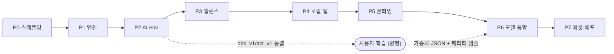

# 개발 계획서 — 드래곤 러쉬 (Dragon Rush)

> 상태: **P0~P7 구현 완료 (2026-11-11)**. 사용자 입력 대기: D4(가중치 포맷 → P6 어댑터), D8(에셋), D9(배포 대상).
>
> | Phase | 결과 |
> |---|---|
> | P0~P2 | 모노레포·엔진·AI 인터페이스·env 서버·Python 클라이언트 완료. env 처리량: 64 env 배치 셀프플레이 약 21,000 step/s |
> | P3 | TS 엔진 재검증 완료(기획서 §15 표). 4인 지표 전부 충족 |
> | P4·P5 | 로컬 웹 플레이, 온라인 서버·로비·재접속·타이머 완료 |
> | P6 | 어댑터 자리·모델 레지스트리·sim `model:<id>`·패리티 도구 준비. **사용자 포맷 수령 후 어댑터만 구현하면 됨** |
> | P7 | Dockerfile·CI 워크플로·문서 갱신 완료. 실제 에셋·배포는 D8·D9 대기 |
> 정본 분담: 규칙·수치 → [game-design.md](game-design.md) · 구조·프로토콜 → [architecture.md](architecture.md) · 관측/행동/env/모델 계약 → [ai-interface-spec.md](ai-interface-spec.md) · 코딩 규칙 → [coding_convention.md](../coding_convention.md) · 워크스페이스 안내 → [README.md](../README.md), [AI_README.md](../AI_README.md)

## 1. 전체 전략
- **엔진 우선 + TDD**: 규칙은 `packages/engine` 한 곳에만 두고 테스트를 먼저 쓴다. 웹·서버·AI·sim이 모두 같은 엔진을 호출하므로, 버그를 한 번 고치면 모든 모드에 반영된다.
- **AI 스펙 조기 동결**: P2가 끝나면 `obs_v1`/`act_v1`을 동결하고 학습 env를 제공한다. 사용자는 이때부터 웹·온라인 개발(P3~P5)과 **병행해서 학습**할 수 있다.
- **로컬 → 온라인 순서**: 핫시트와 vs 봇으로 재미와 UI를 먼저 검증한다. 온라인은 같은 `GameClient` 인터페이스 뒤에 붙이므로 UI를 다시 만들지 않는다.
- **사용자 모델은 어댑터로 격리**: 가중치 JSON 포맷을 받은 뒤 `WeightAdapter`만 구현한다. 그 전에는 `Policy` 인터페이스와 내장 봇으로 AI 좌석 경로 전체를 검증해 둔다.
- **밸런스는 데이터로 관리**: 모든 수치는 `RulesConfig`에 둔다. 설계 단계의 프로토타입 시뮬(4인 20,000판) 결과를 P3에서 실제 TS 엔진으로 재현한다.
- **Phase 단위 진행**: Phase는 완료 기준(DoD, 테스트 포함)을 충족해야 끝난다. 결정이나 승인이 필요한 항목만 확인받고 다음 Phase로 넘어간다.
- **범위는 "게임"까지**: 트레이너(학습 코드)와 가중치 포맷 정의는 사용자 담당이다. 모델 업로드, 계정·DB, 서버 수평 확장은 범위 밖이다.

## 2. 사용자 결정·승인·주의 사항
답이 없으면 **기본안**으로 진행한다. ★ 표시는 진행을 멈추고 확인받는 체크포인트이며, ★ 항목은 답을 받아야 다음 Phase로 넘어간다.

| # | 항목 | 기본안 (답이 없을 때) | 필요 시점 | 영향 |
|---|---|---|---|---|
| D1 | 원격 저장소(GitHub 등) 사용 여부 | 로컬 git만 사용. 원격이 생기면 GitHub Actions CI(lint·typecheck·test)를 추가. 사용자 개인 파일 `prompt.md`는 커밋하지 않는다(`.gitignore` 추가 여부 확인) | P0 | PR 리뷰·CI 가능 여부 |
| D2 | 규칙 열린 질문·구조 변경 R1~R7 (§2.1, 기획서 §16) | 기획서 §16 기본안대로 구현. 모두 `RulesConfig` 값이라 나중에 바꾸는 비용이 작음 | P1 시작 전 권장. R1·R5a·R5b는 승인 완료(2026-11-11). 나머지(R2·R3·R4)는 기본안으로 진행 | 엔진 분기, 밸런스 수치, 관측·마스크 |
| D3 | ★ `obs_v1`/`act_v1` 동결 검토 | ai-interface-spec.md 내용 그대로 동결. 이후 변경은 새 버전(`obs_v2` 등)으로만 | **P2 종료** | 동결 후 바뀌면 사용자 모델 재학습 필요 |
| D4 | 가중치 JSON 포맷 + 통합 정보 + **패리티용 샘플 입출력 쌍** (§2.2) | 받기 전까지 model 좌석은 UI에서 "준비 중"으로 비활성화하고 P6은 보류 | P6 시작 전 (P2 이후 언제든, 빠를수록 P6을 앞당김) | 어댑터·패리티 테스트 가능 여부 |
| D5 | 재접속 유예 만료 후 처리 | 좌석을 HeuristicBot으로 영구 전환하고, 토큰은 관전용으로 강등 | P5 | 끊긴 사람이 복귀할 수 있는지 |
| D6 | 턴 타이머·재접속 유예 시간 | 둘 다 60초(서버 설정 `TURN_TIMEOUT_MS`·`RECONNECT_GRACE_MS`). 모든 사람 결정에 같은 타이머. 반응·선택형 결정을 더 짧게 나누려면 사용자 결정 후 `REACTION_TIMEOUT_MS`를 추가 | P5 | 게임 템포 |
| D7 | 지원 화면 | 데스크톱 브라우저 우선, 태블릿 가로까지. 모바일 세로는 범위 밖 | P4 | UI 레이아웃 작업량 |
| D8 | 에셋 제공 (§4.2 목록, 사용권을 확보한 파일) | 플레이스홀더(CSS/SVG 도형, 무음)로 개발. 플레이스홀더 상태로도 출시 가능 | P7 시작 전 | 완성도·연출 |
| D9 | 배포 대상(호스팅)·도메인 | WebSocket 장기 연결을 지원하는 단일 Node 호스트 1대(VPS, 또는 Render·Fly.io 같은 PaaS). 서버리스 함수형 호스팅은 인메모리 방과 맞지 않아 부적합 | P7 (P5 중 결정 권장) | 비용·HTTPS·운영 방식 |
| D10 | 게임 이름 | **결정됨: "드래곤 러쉬 (Dragon Rush)"** (2026-11-12) | P7 | 타이틀·로고 에셋 |
| D11 | 밸런스 프로토타입 보관 (저장소 구조 변경이라 승인 필요) | 승인되면 `docs/balance/`에 `hero_sim.py`·`configs.py`·`final_metrics.json`을 참고 자료(코드 아님)로 보관. 승인 전까지는 ai-interface-spec §10 봇 요약과 기획서 §15 지표가 기준 | P0 | P3에서 프로토타입과 직접 비교할 수 있는지 |

### 2.1 규칙 열린 질문 한 줄 요약 (R1~R5·R7 상세는 기획서 §16, R6은 기획서 §15)
- **R1 초반 PvP 보호** (승인됨): 라운드 1~3은 같은 칸이어도 싸우지 않고 공존한다(`pvpGraceRounds = 3`, `rush-1`에서 1~2로 줄임). v0 규칙 프로토타입 시뮬에서는 3라운드 안에 37.6%가 탈락했고, 3라운드 보호와 시작 방어막(R5a)을 넣으면 0%가 됐다.
- **R2 텔레포트 턴당 제한**: 1회로 제한할지 무제한으로 둘지. 한 턴 연쇄 습격을 허용할지가 걸려 있다.
- **R3 도둑 아이템**: 일회용이면서 턴당 1회인지. 원문에는 도둑에만 "(일회용)" 표기가 없다.
- **R4 목표 게임 길이·용 처치 비중**: `final-1`은 4인 평균 23라운드, 용 처치 63.7%(목표 40~70%)였다. 한 판 7~10분 목표로 다시 맞춘 `rush-1`은 4인 평균 10.2라운드(p95 15), 용 처치 87.5%(목표 40~75% 미달, 기획서 §15)다.
- **R5 밸런스 구조 변경** (승인됨): R5a 시작 방어막 1개 지급, R5b 닌자 ±1 보정 사용 후 2턴 쿨다운. 관측 필드 `ninjaCooldown`은 `obs_v1`에 포함한다.
- **R6 밸런스 미달 수용 여부**: 2·3인 게임의 아이템 구매 편중(4인은 충족), aggro 성향 봇의 약세(승률 16.6%). 기본안은 수용이고 P3에서 다시 본다.
- **R7 쉬는 턴 범위** (결정됨): 쉬는 턴에는 이동만 막고 강화·도둑·용 도전·턴 종료는 허용한다. 원문 "용은 언제든지 자신의 턴에 도전"과 답변 "강화는 자기 턴이면 어디서나"를 지키는 쪽이다.

### 2.2 모델 통합에 필요한 정보 (D4, 상세 요청 양식은 ai-interface-spec.md)
- 네트워크 구조(층 수·크기), 활성화 함수, 행렬 배치 규칙(행/열 우선, `W·x`인지 `x·W`인지), 입력 정규화
- actor 출력이 logits인지 확률인지, critic 출력 형태, 모델 JSON 메타에 `obs_v1`/`act_v1` 표기(권장)
- **패리티 샘플**: 관측 벡터·행동 마스크 → actor(마스크 전 원출력)/critic 출력 쌍 5개 이상(행동 마스크가 일부 막힌 상태 포함 권장). TS forward 결과와 허용 오차 안에서 일치하는지 검사하는 데 쓴다.

### 2.3 주의
- 학습 코드와 가중치 포맷 정의는 **사용자 담당**이다. 우리는 env 서버, Python 클라이언트, 어댑터까지만 만든다.
- P3에서 수치(`RulesConfig`)가 조금 바뀔 수 있다. 관측·행동 구조는 P2에서 고정되므로 학습 코드는 그대로 쓸 수 있지만, **본격 학습은 P3 종료(수치 확정) 후를 권장**한다. 수치 버전은 `RulesConfig.version`으로 구분한다.
- 온라인은 인메모리 단일 인스턴스다. 서버를 재시작하면 진행 중인 게임이 사라진다(MVP 허용).
- 서버에 모델을 추가하려면 운영자가 `models/`에 파일을 직접 둔다(업로드 기능 없음). 로컬 모드에서는 브라우저 파일 선택도 가능하며, 이 파일은 서버로 전송하지 않는다.

## 3. 핵심 추가 내용
### 3.1 기술 스택·라이브러리
| 이름 | 용도 | 선택 이유 |
|---|---|---|
| TypeScript (strict) | 전 패키지 | 엔진 하나를 서버·브라우저·sim이 공유. 타입으로 Action·Event 계약을 고정 |
| pnpm workspaces | 모노레포 | 빠른 설치. workspace 의존 선언으로 단방향 의존을 강제 |
| Node 22 | 서버, sim, env 서버 | 로컬 설치 버전(LTS) |
| React + Vite | 웹 UI·개발 서버 | 성숙한 생태계, 빠른 HMR |
| Zustand | 웹 상태 | 보일러플레이트가 적고 React 밖(services)에서도 갱신 가능 |
| Socket.IO (server/client) | 온라인 방·실시간 동기화 | room, ack, 자동 재연결 내장 |
| Fastify | HTTP, 정적 파일, `GET /api/models` | 가볍고 빠름. Socket.IO와 같은 포트 사용 |
| zod | 프로토콜 런타임 검증 | 스키마 하나에서 검증과 TS 타입을 함께 얻음 |
| Vitest + fast-check | 단위·통합·속성 테스트 | Vite와 설정 공유. 엔진 불변식을 무작위 행동열로 검증 |
| ESLint(flat) + typescript-eslint + Prettier | 품질 | 엔진의 `Math.random`·`Date`·I/O, 역방향 import를 lint로 금지 |
| sfc32 (자체 구현, 라이브러리 아님) | 시드 PRNG | 엔진 무의존 원칙 유지, 결정성, 상태 역산이 어려움 |
| Python 3.13 + numpy (+ pytest) | 학습 env 클라이언트 | 사용자 Actor-Critic이 numpy 기반. 의존성 최소화 |
| Playwright (선택) | E2E | 브라우저 2개로 온라인 1판 자동 검증 |

- server·sim의 TS 실행·번들 도구(tsx·tsup 후보)는 P0에서 확정하고 AI_README에 추가한다. 위 표에 없는 라이브러리를 추가할 때는 이유를 브리핑한다.

### 3.2 아키텍처 패턴 (상세는 architecture.md §1·§4)
| 패턴 | 적용 위치 | 이유 |
|---|---|---|
| 함수형 코어 / 명령형 셸 | engine·ai는 순수 함수, server·web·sim은 부수효과 | 결정성, 테스트 용이성 |
| Reducer + 표 주도 FSM | `engine` reducer·legal (phase × action 핸들러 표) | 합법 행동을 phase 단위로 국소화 |
| Command | `Action` (직렬화 가능한 데이터) | 전송·검증·로그·리플레이를 한 형태로 처리 |
| Step pipeline | engine 내부 `pipe(step, f, g)` | 이벤트 누적, RNG를 state로 스레딩 |
| 이벤트 로그 | `GameEvent` (결과값 포함) | 애니메이션·게임 로그·리플레이의 공통 원천. UI가 규칙을 재계산하지 않음 |
| 데이터 주도 테이블 + 핸들러 맵 | 칸 효과(직업 패시브는 훅 맵 = 데이터로서의 Strategy) | 새 칸·패시브 = 데이터 추가(OCP). `if (job === …)` 분기 금지 |
| Strategy | `Policy`(Random/Heuristic/Model), `SeatController` | 사람·봇·모델·대리 플레이를 같은 경로로 처리 |
| Adapter | `WeightAdapter` (사용자 JSON → `PolicyModel`) | 포맷이 바뀌어도 어댑터만 교체 |
| Ports & Adapters (DIP) | `GameClient` → `LocalGameClient` / `OnlineGameClient` | UI가 로컬/온라인을 모름 |
| Schema-first | `packages/protocol` (zod) | 런타임 검증과 타입의 단일 정의 |
| 서버 권위 + 버전 검사 | `GameSession.submit` 단일 경로, `stateVersion` | 부정행위 방지, 중복 제출·타이머 경합을 "먼저 도착한 하나만 적용"으로 해결 |
| Observer, Producer–Consumer | Zustand store+selector, 이벤트 애니메이션 큐 | 최소 렌더, 서버 갱신 속도와 연출 속도 분리 |

## 4. 기타 중요 사항

### 4.1 Phase 계획

P6의 어댑터·패리티 부분은 `engine`·`ai`에만 의존한다. 포맷을 일찍 받으면 P3~P5와 병행해 먼저 진행한다.

#### P0 — 모노레포·툴링 스캐폴딩
- **목표**: 빈 패키지 6개와 Python 패키지 골격이 빌드·린트·테스트 파이프라인을 통과한다.
- **산출물**: `pnpm-workspace.yaml`, 루트 스크립트(`dev`/`test`/`lint`/`typecheck`/`build`/`sim`/`env-server`), `tsconfig.base.json`(strict, `noUncheckedIndexedAccess`), ESLint flat config, Prettier, Vitest 루트 설정, 패키지별 smoke 테스트, `python/pyproject.toml`.
- **엔진 순수성 lint**: `packages/engine`에서 `Math.random`·`Date`·`node:*`/`fs` import·다른 `@dragon-rush/*` import를 금지한다.
- **DoD**: `pnpm install && pnpm lint && pnpm typecheck && pnpm test && pnpm build`가 성공한다. 엔진에 `Math.random()`을 넣으면 lint가 실패하는지 확인한다. `pnpm dev`로 빈 웹 페이지가 뜨고 서버 `/health`가 응답한다.
- **확인**: D1(원격 저장소).

#### P1 — 규칙 엔진 코어 (TDD)
- **목표**: 기획서 규칙 전부를 순수·결정적 엔진으로 구현한다(`createGame`/`getLegalActions`/`applyAction`/`toPublicState`).
- **산출물**: `types`, `rng`(sfc32), `rules`(`DEFAULT_RULES`, `validateRules`), `board`, `economy`, `combat`, `jobs`(패시브 훅), `tiles`(효과 핸들러, 미지의 동굴), `movement`, `duel`, `dragon`, `items`, `turn`, `reducer`/`legal`/`public`.
- **DoD**:
  - 모듈마다 실패하는 테스트를 먼저 쓴다(고정 시드). 엔진 line coverage는 90% 이상이다.
  - 속성 테스트(fast-check)로 임의 시드와 임의 합법 행동열에서 불변식을 확인한다: `1 ≤ hp ≤ maxHp`, `coins ≥ 0`, `pending ≠ null`이면 합법 행동 1개 이상, 입력 state 불변, 같은 시드·행동이면 같은 결과, `maxRounds` 안에 종료.
  - 골든 테스트: 고정 시드 행동 스크립트의 이벤트 로그 스냅샷, `DEFAULT_RULES`와 기획서 수치의 일치, 선택류 phase의 합법 행동 순서(시간 초과 기본 행동의 근거, architecture §8.2).
- **확인**: D2(규칙 열린 질문). 시작 전에 답을 받는 것이 좋고, 답이 없으면 기본안을 설정값으로 구현한다. R1·R5는 승인 완료.

#### P2 — AI 인터페이스·학습 환경
- **목표**: 사용자가 Python에서 학습을 시작할 수 있는 환경을 제공하고, `obs_v1`/`act_v1`을 동결한다.
- **산출물**:
  - `packages/ai`: `encodeObservation`(obs_v1), 행동 코덱·마스크(act_v1, 상대 좌석 변환), `Policy`, RandomBot, HeuristicBot(성향 파라미터).
  - `packages/sim`: 헤드리스 시뮬레이터와 `pnpm sim` CLI, env 서버 `pnpm env-server`(stdio JSONL, 배치 N env, 단일 에이전트/셀프플레이).
  - `python/rpgboard_env`(numpy만, Gymnasium 스타일 `reset()`/`step()`, 행동 마스크·`acting_seat` 제공), `python/examples/random_agent.py`, 빠른 시작 안내.
- **DoD**:
  - 모든 도달 상태에서 마스크와 `getLegalActions`가 일치하고, 코덱 왕복 `decode(encode(a)) = a`가 성립한다(속성 테스트). `obs_v1` 골든 벡터 테스트를 둔다.
  - env 서버 JSONL 왕복 통합 테스트와 pytest를 통과한다. `random_agent.py`가 1,000 에피소드를 오류 없이 끝내고, 같은 시드면 같은 궤적이 나온다.
  - 처리량(step/s)을 측정해 기록한다. 기준선은 배치 env에서 5,000 step/s 이상이고, 미달이면 보고한다.
- **확인 ★**: D3(obs/act 동결 검토). 승인 후 사용자는 학습을 시작할 수 있다. 이 시점에 D4 정보를 요청한다.

#### P3 — 밸런스 검증
- **목표**: 설계 단계 Python 프로토타입의 밸런스 결과를 실제 TS 엔진과 봇으로 재현하고 수치를 확정한다.
- **산출물**: `pnpm sim` 리포트(직업 승률, 게임 길이 중앙값·p95, 용 처치 비중·라운드, 3라운드 내 탈락률, PvP 횟수, 아이템 구매 비중, 선공 승률, 턴당 코인), `DEFAULT_RULES` 확정(`version` 갱신), 기획서 수치 갱신.
- **DoD**: 4인 20,000판, 3인·2인 각 5,000판에서 기획서 목표 지표를 충족한다(프로토타입 기준 4인 평균 23.3라운드, 직업 승률 23.8~26.4%). 프로토타입과 차이가 크면 엔진 버그인지 규칙·봇 차이인지 원인을 밝힌다(프로토타입 코드를 보관한 경우(D11) 직접 비교, 아니면 ai-interface-spec §10 봇 정본과 기획서 §15 지표 기준). 불변식 검사도 통과해야 한다.
- **확인**: D2-R6(미달 항목 수용), 수치 확정 공지(본격 학습 시작 시점).

#### P4 — 웹 클라이언트 로컬 플레이
- **목표**: 브라우저에서 핫시트(2~4인)와 vs 봇으로 한 판을 끝까지 플레이한다. 서버는 필요 없다.
- **산출물**: 페이지(Home, LocalSetup, Game, Result), 보드(DOM/SVG 24칸 링), HUD(스탯·코인·아이템), phase별 결정 다이얼로그(강화, 구매, 텔레포트 칸 선택, 도둑 대상, 방어막, 수련장, 닌자 보정), 게임 로그, `LocalGameClient`, Zustand slice, 이벤트 애니메이션 큐(배속·건너뛰기).
- **DoD**:
  - services·store·`eventTimeline` 단위 테스트를 둔다. 버튼 활성화는 `legalActions`로만 하고 UI에 규칙 코드가 없다.
  - 핫시트 4인과 vs HeuristicBot 각 1판을 수동 체크리스트로 완주한다. 방어자 결정 창은 해당 플레이어 이름으로 뜬다.
- **확인**: 플레이 가능한 빌드로 UI 흐름 검토(선택), D7.

#### P5 — 온라인 멀티플레이
- **목표**: 방 코드로 사람·봇을 섞은 2~4인 온라인 대전을 한다. 서버 권위 방식이다.
- **산출물**:
  - `packages/protocol`: zod 스키마, 메시지, 오류 코드, `PROTOCOL_VERSION`.
  - `apps/server`: `RoomManager`/`Room`, `SessionStore`, `GameSession`(submit 단일 경로), `TurnTimer`, `SeatController`, `PolicyRunner`, `timeoutAction`, rate limit.
  - `apps/web`: Lobby, `OnlineGameClient`, 좌석 연결 상태 표시, 재접속(`sessionToken`).
- **DoD**: 인프로세스 서버와 socket.io-client로 다음 통합 테스트를 통과한다.
  - 방 생성 → 입장 → 직업 선택 → 시작 → 봇 포함 1판 종료.
  - `STALE_VERSION` 경합(중복 제출, 타이머 대 사람, 대리 봇 대 복귀자), 재접속 유예·만료, 타임아웃 기본 행동, 연속 3회 시간 초과 → 봇 대리 → 사람 입력 시 해제(fake timers).
  - `INVALID_PAYLOAD`, 남의 좌석으로 제출 불가.
  - 브라우저 2개로 수동 1판을 진행한다.
- **확인**: D5, D6, D9(배포 대상은 이 시점에 정하는 것을 권장).

#### P6 — 사용자 모델 통합 (포맷을 받으면 앞당길 수 있음)
- **목표**: 사용자 가중치 JSON을 로컬·온라인 AI 좌석에서 사용한다.
- **산출물**: `WeightAdapter`(사용자 포맷 → `PolicyModel`), 순수 TS forward, `ModelPolicy`(마스크 적용 → argmax/샘플링), 서버 `modelRegistry` + `GET /api/models`, 웹 모델 선택(목록, 파일 선택), 로비 model 좌석 활성화.
- **DoD**:
  - **패리티 테스트**: 사용자 샘플 입력 → 출력 쌍과 TS forward 결과가 허용 오차 안에서 일치한다(기본값은 ai-interface-spec §11의 `abs(ts − ref) ≤ 1e-5 + 1e-5·abs(ref)`, 사용자와 합의하면 변경).
  - model 좌석 1,000판 sim에서 불법 행동 0회, HeuristicBot 대비 승률 리포트를 낸다.
  - 형식이 잘못된 JSON은 등록에서 제외되고 로그만 남는다(서버는 계속 동작).
- **확인 ★**: 사용자가 실제 모델로 1판을 플레이해 확인한다.

#### P7 — 에셋·연출·배포
- **목표**: 실제 에셋을 적용하고 연출을 다듬어 공개 배포한다.
- **산출물**: 에셋 교체(§4.2), BGM·효과음(음량·음소거 설정), 연출 타이밍 조정, 프로덕션 빌드(단일 Node 서비스: Fastify가 web dist 제공 + Socket.IO), 배포 설정, README·AI_README 실행법 갱신, Playwright E2E(선택).
- **DoD**: `pnpm build` 후 단일 프로세스로 온라인 1판을 진행한다. 배포 환경에서 기기 2대로 1판을 진행한다. 에셋이 없으면 플레이스홀더로 대체되고 오류가 없다. E2E(선택)로 핫시트 1판과 온라인 1판을 검증한다.
- **확인**: D8, D9, D10.

### 4.2 에셋 요청 목록
- 기본 위치는 `apps/web/public/assets/`다(아래 경로는 이 폴더 기준). 개발은 **플레이스홀더**로 진행하므로 늦게 받아도 일정이 막히지 않는다.
- 이미지는 PNG(투명 배경), 오디오는 MP3(OGG도 가능)로 받는다. **상업적 사용이 가능한 사용권을 확보한 파일**만 받는다.
- 주사위, 보드 칸 테두리, 버튼은 CSS/SVG로 직접 만들므로 에셋이 필요 없다.

| 용도 | 경로/파일명 | 형식·권장 크기 | 필요 Phase |
|---|---|---|---|
| 직업 초상화 (직업 선택, HUD) | `images/jobs/{swordsman,archer,mage,ninja,berserker}.png` (5개) | PNG 512×512 | P7 (P4부터 적용 가능) |
| 보드 말(토큰) (선택, 없으면 초상화 축소) | `images/tokens/{swordsman,archer,mage,ninja,berserker}.png` | PNG 128×128 | P7 |
| 용 (용 도전 연출, 보드 중앙) | `images/dragon/dragon.png` | PNG 1024×1024 | P7 |
| 보드 배경 | `images/board/board_bg.png` | PNG 또는 WebP 2048×2048 | P7 |
| 칸 아이콘 (칸 종류마다 1개, 파일명은 칸 id 소문자) | `images/tiles/{start,goblin,poison_swamp,herb,bandit,training,shop,wolf,trap,treasure,pickpocket,blacksmith,inn,orc,cursed_altar,fountain,rockfall,mystery,troll,spider_web,wandering_merchant,storm}.png` (22개) | PNG 256×256 | P7 (P4부터 적용 가능) |
| 아이템 아이콘 | `images/items/{teleport,shield,thief}.png` | PNG 256×256 | P7 (P4부터 적용 가능) |
| 스탯·코인 아이콘 (선택, 없으면 SVG) | `images/ui/{atk,def,hp,coin}.png` | PNG 64×64 | P7 |
| 미지의 동굴 카드 그림 (선택) | `images/cards/{hidden_gold,gem_vein,ancient_relic,healing_spring,giant_blessing,lost_bag,cave_in,goblin_trick,bat_swarm,lost_in_dark}.png` (10개) | PNG 512×768 | P7 |
| 타이틀 로고 (D10 확정 후) | `images/ui/logo.png` | PNG 1024×512 | P7 |
| BGM — 로비·메인 화면 (루프) | `audio/bgm/lobby.mp3` | 1~3분 루프, 128~192kbps | P7 |
| BGM — 보드 진행 (루프) | `audio/bgm/board.mp3` | 1~3분 루프 | P7 |
| BGM — 용 전투 | `audio/bgm/dragon_battle.mp3` | 30초~2분 루프 | P7 |
| 효과음 — 주사위, 말 이동, 공격 타격, 코인 | `audio/sfx/{dice_roll,move_step,attack_hit,coin}.mp3` | 각 2초 이하, 음량 정규화 | P7 |
| 효과음 — 강화, 아이템 사용, 방어막, 용 브레스 | `audio/sfx/{upgrade,item_use,shield,dragon_breath}.mp3` | 각 2초 이하 | P7 |
| 효과음 — 승리, 탈락(패배) | `audio/sfx/{victory,defeat}.mp3` | 각 5초 이하 | P7 |

### 4.3 리스크와 대응
| 리스크 | 영향 | 대응 |
|---|---|---|
| 사용자 모델 포맷이나 수치 정밀도가 맞지 않음 | 패리티 실패, 모델 좌석 오동작 | 샘플 입출력 쌍과 허용 오차를 미리 합의한다. 필요하면 TS forward를 float64로 계산한다. 차이는 어댑터 안에서만 흡수한다 |
| 동결 후 `obs`/`act` 변경 | 사용자 재학습 필요 | P2 검토 체크포인트(★)를 둔다. 관측·마스크에 영향을 주는 규칙(R1·R5)은 이미 확정했다. 변경은 새 버전으로만 하고 골든 테스트로 보호한다 |
| TS 엔진과 프로토타입 밸런스가 다르거나 규칙 결정이 늦어짐 | 재튜닝, 학습 환경 변화 | 모든 수치를 `RulesConfig`에 둔다. P3에서 재현하고 비교한다. 수치가 바뀌면 `RulesConfig.version`을 올리고 공지한다 |
| 온라인 동기화 경합·재접속 버그 | 상태 불일치, 이중 적용 | 모든 입력을 `submit` 단일 경로와 `stateVersion`으로 처리한다. fake timer 통합 테스트로 경합 시나리오를 고정한다 |
| env 처리량 부족 (stdio JSON 직렬화 병목) | 학습 속도 저하 | 배치 N env를 지원하고 P2 DoD에서 측정한다. 부족하면 env 서버를 여러 프로세스로 띄우고, 바이너리 인코딩은 다음 버전에서 검토한다 |

### 4.4 작업 운영 (상세는 [coding_convention.md](../coding_convention.md))
- **브랜치**: `main`에는 직접 커밋하지 않는다. `feature/xxx`, `bugfix/xxx`, `docs/xxx` 등을 쓴다(예: `feature/p1-engine-combat`). 작업이 끝나면 `main`에 병합한다.
- **커밋**: 영어로 쓰고 Conventional Commits를 따른다(예: `feat(engine): resolve shield decision order`, `test(ai): add obs_v1 golden vectors`). 테스트와 구현은 같은 커밋에 둔다(coding_convention 규칙 8).
- **Phase 단위 진행**: DoD를 충족하면 결정·승인이 필요한 항목만 보고하고 다음 Phase로 간다. 대규모 구조 변경이나 다수 파일 수정이 필요하면 착수 전에 범위와 이유를 브리핑하고 승인받는다.
- **TDD**: 실패하는 테스트 → 구현 → 리팩터 순서로 진행한다. 버그 수정은 재현 테스트부터 쓴다.
- **문서 동기화**: 구조·라이브러리·명령이 바뀌면 같은 작업 안에서 AI_README.md와 README.md를 갱신한다. AI 에이전트는 작업 전에 AI_README.md로 워크스페이스를 파악한다.
- **모호하면 질문**: 규칙·범위가 모호하면 추측해서 구현하지 않고 먼저 묻는다. 주석은 영어로, 꼭 필요한 곳에만 단다.
