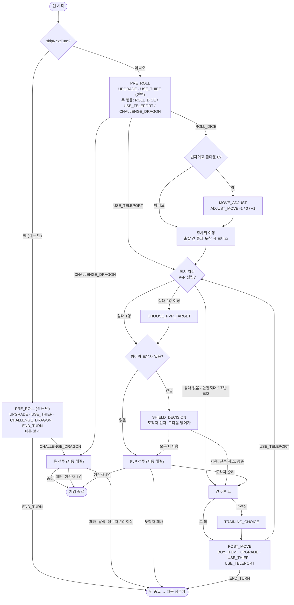

# 게임 기획서 — 드래곤 러쉬 (Dragon Rush)

> 상태: **기획 단계 (코드 없음)**. 이 문서는 **게임 규칙·수치의 정본**이다. 엔진의 `DEFAULT_RULES`(`RulesConfig`)는 이 문서와 같아야 하며, 일치 여부는 골든 테스트로 보장한다.
> 관련 문서: 구조·멀티플레이 프로토콜 [architecture.md](architecture.md) · 관측/행동/보상/학습 env [ai-interface-spec.md](ai-interface-spec.md) · 일정·결정 [development-plan.md](development-plan.md)
> 현재 수치는 **`rush-1`**(2026-11-12)이다. 설계 단계 Python 프로토타입 밸런스 시뮬(config `final`, 저장소 밖 참고 자료)에서 나온 `final-1`을 TS 엔진 시뮬로 한 판 7~10분 목표에 맞춰 다시 조정했다(§15). **(승인됨)** 표시는 시뮬 결과로 넣은 구조 변경이며, 사용자가 승인했다(§16, 2026-11-11).

## 1. 개요
| 항목 | 내용 |
|---|---|
| 이름 | 드래곤 러쉬 (Dragon Rush) |
| 장르 | 웹 턴제 주사위 보드게임 + 경량 RPG(성장·1:1 결투·보스) |
| 인원 | 2~4명. 사람·봇·사용자 AI 모델을 자유롭게 조합 |
| 플레이 모드 | 로컬 핫시트, vs AI, 온라인 멀티플레이 (§13) |
| 예상 플레이 시간 | **한 판 7~10분 목표.** 평균 라운드 수는 4인 10.2(p95 15), 3인 10.1, 2인 9.2(시뮬, §15). 보드 턴 10초, 결투 25초, 용전 40초로 가정하면 4인 평균 약 7분(p95 약 9분), 3인 약 5.5분, 2인 약 3.5분이다. 사람 턴이 길수록 늘어난다 (추정) |

| # | 디자인 기둥 | 규칙에서 구현되는 방식 |
|---|---|---|
| 1 | **언제 용에 도전할 것인가** | 코인으로 강해지는 성장과 용 도전의 결단. 지면 즉시 탈락하므로 "충분히 강해진 때"를 스스로 판단해야 한다 |
| 2 | **같은 칸 = 1:1 결투** | 위치가 곧 위협이 된다. 방어막·텔레포트·닌자 보정으로 결투를 피하거나 사냥한다 |
| 3 | **공개 정보·결정적 규칙** | 스탯·코인·아이템이 모두 공개되고, 비공개는 RNG 상태뿐이다. 사람·봇·학습 AI가 같은 규칙과 같은 정보로 겨룬다 |

## 2. 승리 조건 / 탈락
| 종류 | 조건 | 결과 |
|---|---|---|
| 용 처치 | 자기 턴에 `CHALLENGE_DRAGON`으로 용 전투에 승리 | 즉시 승리하고 게임 종료 (다른 생존자가 있어도) |
| 최후 생존 | 생존자가 1명이 됨 | 그 1명이 즉시 승리 (남의 턴에 방어하다 이겨도) |
| 무승부 | `maxRounds` 라운드가 끝남 | 생존자 전원 무승부. 사람 게임은 기본 꺼짐(방 옵션), 학습 env는 기본 100 |

| 탈락 원인 | 처리 |
|---|---|
| PvP 패배 | 즉시 탈락. 승자가 패자 코인의 절반(내림)과 아이템 전부를 받고, 나머지 코인은 소멸 |
| 용 전투 패배 | 즉시 탈락. 코인과 아이템은 **소멸**한다(누구에게도 가지 않음) |

- 칸·카드 이벤트로는 죽지 않는다(HP 최소 1). 사망은 PvP와 용 전투에서만 일어난다.
- 탈락자는 보드에서 제거되고, 남은 게임은 관전한다.

## 3. 게임 준비
1. **좌석 구성**: 2~4석. 각 좌석은 사람, 봇, 모델 중 하나다.
2. **직업 선택**: 게임 시작 전에 고르며 **중복은 불가**하다(5직업 중 인원수만큼).
3. **턴 순서**: 게임을 만들 때 시드로 섞고, 섞인 순서대로 좌석 번호 0..n-1을 다시 매긴다. 이 순서는 게임 내내 고정된다.

| 시작 상태 | 값 |
|---|---|
| 위치 | 전원 0번(출발) 칸 |
| `hp` / `maxHp` / `atk` / `def` | 직업 기본값 (HP 가득 참) |
| `coins` | 10 |
| 아이템 | **방어막(`shield`) 1개** (승인됨, §16 R5a) |
| 강화 레벨 | `atk`·`def`·`maxHp` 모두 0 |
| 패시브 상태 | 검사 불굴 미사용, 닌자 쿨다운 0, `skipNextTurn` 없음 |
| 라운드 | 1부터 시작. **라운드 1~2는 초반 보호**(PvP 없음) (승인됨, §16 R1) |

## 4. 스탯과 직업
| 스탯 | 식별자 | 설명 |
|---|---|---|
| 최대 체력 | `maxHp` | HP 상한. 체력 강화(+6)와 거인의 축복(+5)으로 오른다 |
| 현재 체력 | `hp` | 전투와 이벤트 피해가 누적되며 자동 회복은 없다. 출발 보너스·약초·샘·여관·카드로 회복하고, 회복량은 `maxHp`에서 잘린다 |
| 공격력 | `atk` | 1회 피해 = `max(1, atk + 1d6 − 상대 def)` |
| 방어력 | `def` | 받는 피해를 줄인다. 최소 피해 1은 막지 못한다 |
| 코인 | `coins` | 강화와 아이템 비용으로 쓴다. 0 아래로 내려가지 않는다 |
| 강화 레벨 | 스탯별 | 강화 비용 계산에만 쓴다. 유료 강화와 수련장으로만 오른다 |

| 직업 | id | HP | ATK | DEF | 패시브 | 플레이 스타일 |
|---|---|---|---|---|---|---|
| 검사 | `swordsman` | 53 | 5 | 5 | **불굴** | 체력이 가장 두꺼운 정면 승부형. 한 번 더 버티는 보험 덕분에 결투와 용 도전이 안정적이다 |
| 궁수 | `archer` | 39 | 6 | 6 | **선제 사격** | 언제나 먼저 쏘는 사냥꾼. 짧은 결투와 약해진 상대 저격에 강하다 |
| 마법사 | `mage` | 40 | 4 | 5 | **마력 관통** | 방어력이 높은 상대와 용에게 강하다. 공격력 강화 효율이 가장 좋다 |
| 닌자 | `ninja` | 34 | 4 | 5 | **그림자 걸음 + 회피** | 칸을 골라 밟으며 경제를 굴리고 결투는 피하는 기동·경제형 |
| 광전사 | `berserker` | 47 | 5 | 5 | **광폭화** | 맞을수록 강해지는 역전형 탱커 |

설계 원칙: 기본 `atk` ≤ `def`로 둔다. 전투 공식 특성상 `atk − def`가 +1만 되어도 HP 64 미만에서는 동일 스탯 선공 승률이 0.60을 넘기 때문이다. 직업 간 차이는 HP와 패시브로 만든다.

| 패시브 | 상세 규칙 |
|---|---|
| 불굴 (검사) | 게임당 1회 자동 발동. 피격으로 `hp`가 0 이하가 될 때 HP 1로 버틴다. PvP·용 모두 적용되고, 사용 여부는 공개 정보다 |
| 선제 사격 (궁수) | 모든 전투(공격·방어·용전)에서 항상 선공하고, 그 전투의 첫 공격 피해에 +3 (최소 피해 1을 적용한 뒤 더함) |
| 마력 관통 (마법사) | 공격할 때 상대 `def`를 `floor(def / 2)`로 계산한다. 용에게도 적용된다(DEF 6 → 3) |
| 그림자 걸음 (닌자) | 주사위를 굴린 뒤 −1/0/+1 중 하나를 고른다. 최종 이동은 1~7이며, 주사위가 1이면 −1은 고를 수 없다. **±1을 쓰면 쿨다운 2**가 걸린다. 쿨다운은 자기 턴이 시작될 때마다 1씩 줄고(쉬는 턴 포함) 0일 때만 보정할 수 있다. 결과적으로 바로 다음 자기 턴에는 쓸 수 없다(최대 2턴에 1번). 쿨다운 중에는 `MOVE_ADJUST` 단계를 건너뛰고, 0을 고르면 쿨다운이 걸리지 않는다. 텔레포트에는 적용되지 않는다 (쿨다운은 승인됨, §16 R5b) |
| 회피 (닌자) | 피격마다 1/8 확률(1d8 = 1)로 피해가 0이 된다. 브레스와 궁수의 첫 사격을 포함한 모든 피격에 적용된다 |
| 광폭화 (광전사) | 공격할 때마다 판정한다. `2·hp ≤ maxHp`이면 `atk_eff = floor(atk × 1.3)`이며, 정수 연산 `floor(atk × 13 / 10)`으로 계산한다. 전투 도중에도 발동한다 |

## 5. 보드
24칸 순환 링(0~23, 시계 방향)이며 코너는 0/6/12/18이다. 이동은 주사위 1개(1d6)로 한다. 칸 이벤트는 고정 배치다.

| # | id | 이름 | 분류 | 효과 |
|---|---|---|---|---|
| 0 | `START` | 출발 | 특수 | **안전지대**(PvP 없음, 여러 명 공존). 주사위 이동으로 통과하거나 도착하면 **코인 +20, HP +6** |
| 1 | `GOBLIN` | 고블린 무리 처치 | 좋음 | 코인 +6 (원문 예시 값 +3의 2배, `rush-1`) |
| 2 | `POISON_SWAMP` | 독 늪 | 나쁨 | HP −5 |
| 3 | `HERB` | 약초 군락 | 좋음 | HP +8 |
| 4 | `BANDIT` | 산적의 습격 | 나쁨 | 코인 −4 |
| 5 | `TRAINING` | 수련장 | 좋음 | 원하는 스탯 1단계 무료 강화(`TRAINING_CHOICE`, 레벨 +1) |
| 6 | `SHOP` | 상점 | 특수 | 아이템 구매 |
| 7 | `WOLF` | 늑대 무리 처치 | 좋음 | 코인 +10, HP −3 |
| 8 | `TRAP` | 가시 함정 | 나쁨 | HP −6 |
| 9 | `TREASURE` | 보물 상자 | 좋음 | 코인 +12 |
| 10 | `PICKPOCKET` | 소매치기 | 나쁨 | 코인 −6 |
| 11 | `BLACKSMITH` | 대장장이의 축복 | 좋음 | `def` +1 (레벨 불변) |
| 12 | `INN` | 여관 | 좋음 | HP +20 |
| 13 | `ORC` | 오크 전사 처치 | 좋음 | 코인 +12, HP −4 |
| 14 | `CURSED_ALTAR` | 저주받은 제단 | 나쁨 | 코인 −6 |
| 15 | `FOUNTAIN` | 행운의 샘 | 좋음 | 코인 +6, HP +6 |
| 16 | `ROCKFALL` | 낙석 | 나쁨 | HP −5 |
| 17 | `MYSTERY` | 미지의 동굴 | 특수 | 동굴 카드 1장 |
| 18 | `SHOP` | 상점 | 특수 | 아이템 구매 |
| 19 | `TROLL` | 트롤 처치 | 좋음 | 코인 +16, HP −7 |
| 20 | `SPIDER_WEB` | 거미줄 늪 | 나쁨 | 다음 자기 턴 1회 쉼 |
| 21 | `WANDERING_MERCHANT` | 떠돌이 상인 | 좋음 | 무작위 아이템 1개 (3종 균등) |
| 22 | `STORM` | 폭풍 | 나쁨 | 코인 −2, HP −3 |
| 23 | `MYSTERY` | 미지의 동굴 | 특수 | 동굴 카드 1장 |

좋음 11칸, 나쁨 8칸, 특수 5칸이다. 이벤트 피해로는 HP가 1 아래로, 코인이 0 아래로 내려가지 않는다.

배치도 (7×7 테두리 링). 윗줄은 왼쪽→오른쪽, 오른쪽 줄은 위→아래, 아랫줄은 오른쪽→왼쪽, 왼쪽 줄은 아래→위로 진행한다. 약어는 id 앞 글자다.
```
[00 STRT][01 GOBL][02 POIS][03 HERB][04 BAND][05 TRNG][06 SHOP]
[23 MYST]                                             [07 WOLF]
[22 STRM]                                             [08 TRAP]
[21 MRCH]                 DRAGON LAIR                 [09 TRES]
[20 WEB ]              (CHALLENGE_DRAGON)             [10 PICK]
[19 TROL]                                             [11 SMTH]
[18 SHOP][17 MYST][16 ROCK][15 FOUN][14 ALTR][13 ORC ][12 INN ]
```

**미지의 동굴 카드 덱** (10장). 뽑을 때마다 10장 중 균등하게 1장을 뽑는 복원 추출이다(덱 상태와 숨은 정보가 없다). 모든 효과는 자동이며, 이동이나 전투를 일으키는 카드는 없다.

| id | 이름 | 분류 | 효과 |
|---|---|---|---|
| `HIDDEN_GOLD` | 숨겨진 금화 | 좋음 | 코인 +12 |
| `GEM_VEIN` | 보석 광맥 | 좋음 | 코인 +8 |
| `ANCIENT_RELIC` | 고대 유물 | 좋음 | `atk` +1 (레벨 불변) |
| `HEALING_SPRING` | 치유의 샘물 | 좋음 | HP +15 |
| `GIANT_BLESSING` | 거인의 축복 | 좋음 | `maxHp` +5 (`hp`도 +5, 레벨 불변) |
| `LOST_BAG` | 잃어버린 가방 | 좋음 | 무작위 아이템 1개 (3종 균등) |
| `CAVE_IN` | 동굴 붕괴 | 나쁨 | HP −7 |
| `GOBLIN_TRICK` | 도깨비 장난 | 나쁨 | 코인 −6 |
| `BAT_SWARM` | 박쥐 떼 | 나쁨 | 코인 −4, HP −3 |
| `LOST_IN_DARK` | 어둠 속 길 잃음 | 나쁨 | 다음 자기 턴 1회 쉼 |

## 6. 턴 진행
1. **턴 시작**: 닌자 쿨다운이 1 줄어든다. `skipNextTurn`이면 이번 턴은 **쉬는 턴**이다. 이동(주사위·텔레포트)만 불가하고, `PRE_ROLL`에서 강화·도둑·용 도전 또는 `END_TURN`을 할 수 있다. `skipNextTurn`은 턴이 끝날 때 소모된다(`TurnSkipped`).
2. **`PRE_ROLL`**: 강화와 도둑을 자유롭게 쓴 뒤 **주 행동 1개**를 고른다. 주사위(`ROLL_DICE`), 텔레포트(`USE_TELEPORT`), 용 도전(`CHALLENGE_DRAGON`) 중 하나다. 쉬는 턴이 아니면 이동 없이 턴을 넘길 수는 없다.
3. **`MOVE_ADJUST`** (닌자, 쿨다운 0일 때만): 주사위 결과에 −1/0/+1을 적용한다.
4. **이동**: 주사위 이동이 출발 칸을 지나거나 출발 칸에 도착하면(`위치 + 이동 칸 수 ≥ 24`) 출발 보너스를 1회 받는다. 텔레포트에는 보너스가 없다.
5. **착지 처리** (주사위 착지와 텔레포트 착지가 같다). 순서는 고정이다.
   1. PvP 판정: 안전지대이거나 초반 보호 중이거나 생존 상대가 없으면 4번(칸 이벤트)으로 건너뛴다. 상대가 1명이면 자동으로 대상이 되고, 2명 이상이면 `CHOOSE_PVP_TARGET`으로 1명을 고른다.
   2. `SHIELD_DECISION`: 방어막을 가진 사람에게만 묻는다. 도착자가 먼저 정하고, 도착자가 쓰지 않으면 방어자가 정한다. 누가 쓰든 전투는 취소되고 두 사람은 그 칸에 공존한다.
   3. 전투(자동 해결) → 패자 탈락 → 전리품 이전. **도착자가 지면 여기서 턴이 끝난다.**
   4. 칸 이벤트(도착자에게만 적용). 수련장이면 `TRAINING_CHOICE`를 거친다. 상점이면 구매 가능(`canBuy`)이 켜진다.
6. **`POST_MOVE`**: 구매·강화·도둑·텔레포트를 쓴 뒤 `END_TURN`. 텔레포트를 쓰면 5단계(착지 처리)를 다시 거쳐 `POST_MOVE`로 돌아온다.



| phase | 결정자 | 가능한 행동 | 비고 |
|---|---|---|---|
| `PRE_ROLL` | 턴 플레이어 | `UPGRADE{stat}` (반복 가능), `USE_THIEF{target}` (턴당 1회) + 주 행동 `ROLL_DICE` / `USE_TELEPORT{tile}` / `CHALLENGE_DRAGON` | `END_TURN`은 쉬는 턴에만 있다(그때는 `ROLL_DICE`·`USE_TELEPORT`가 없다). 텔레포트를 쓰면 그 턴에는 주사위도 용 도전도 없다 |
| `MOVE_ADJUST` | 닌자 | `ADJUST_MOVE{delta: -1, 0, +1}` | 쿨다운 중이면 단계를 생략한다. 주사위가 1이면 −1 불가 |
| `CHOOSE_PVP_TARGET` | 도착자 | `CHOOSE_PVP_TARGET{target}` | 비안전 칸에 생존 상대가 2명 이상일 때 |
| `SHIELD_DECISION` | 도착자 → 방어자 | `SHIELD_DECISION{use}` | 보유자에게만 묻는다. 방어자 차례가 유일한 비턴 결정이다 |
| `TRAINING_CHOICE` | 도착자 | `CHOOSE_TRAINING_STAT{stat: atk, def, maxHp}` | 거부할 수 없다 |
| `POST_MOVE` | 턴 플레이어 | `BUY_ITEM{item}` (`canBuy`일 때), `UPGRADE{stat}`, `USE_THIEF{target}`, `USE_TELEPORT{tile}`, `END_TURN` | 텔레포트를 쓰면 착지 처리 후 다시 `POST_MOVE` |

- 비용이 드는 행동은 코인이 충분할 때만 할 수 있다. 전투, 이동, 칸 이벤트, 턴 시작·종료는 엔진이 자동으로 진행하며 `GameEvent`로 기록한다.
- **합법 행동이 정확히 1개인 결정은 자동으로 적용된다**(예: 코인과 아이템이 없어 `POST_MOVE`에 `END_TURN`만 남은 경우). 따라서 사람과 AI가 받는 결정에는 항상 선택지가 2개 이상 있다.

## 7. 경제
| 구분 | 출처 | 양 |
|---|---|---|
| 획득 | 시작 / 출발 보너스 | 10 / 주사위 이동으로 통과·도착할 때마다 +20 (HP +6도 함께) |
| 획득 | 좋은 칸 | 고블린 +6, 늑대 +10, 보물 +12, 오크 +12, 샘 +6, 트롤 +16 |
| 획득 | 동굴 카드 | 숨겨진 금화 +12, 보석 광맥 +8 |
| 이전 | 도둑 / PvP 승리 | 상대에게서 최대 10 / 패자 코인의 절반(내림) |
| 손실 | 나쁜 칸 / 동굴 카드 | 산적 −4, 소매치기 −6, 제단 −6, 폭풍 −2 / 도깨비 장난 −6, 박쥐 떼 −4 |
| 소비 | 스탯 강화 / 아이템 | 아래 표 / 텔레포트 6, 방어막 6, 도둑 5 |
| 소멸 | 탈락 | PvP 패자 코인 중 승자에게 가지 않은 나머지, 용 패배자의 코인 전부 |

`rush-1`은 `final-1`의 칸·카드·출발 보너스·시작 코인을 모두 2배로 올리고, 강화 비용과 아이템 가격은 그대로 두었다. 즉 성장 속도가 약 2배다. 시뮬(4인) 기준 턴당 순 코인(획득 − 이벤트 손실)은 4.58이다(§15). 지출은 턴당 강화 약 5.35, 아이템 구매 약 0.22로, 코인 대부분이 성장에 들어간다(지출에는 시작 코인과 도둑·전리품으로 넘어온 코인도 포함). 닌자는 칸을 골라 밟아 턴당 6.61을 벌고, 다른 직업은 4.0~4.1이다.

**스탯 강화**: 자기 턴의 `PRE_ROLL`·`POST_MOVE`이면 위치와 상관없이 할 수 있다. 비용은 `기본비용 + 해당 스탯 레벨 × 1`이다.

| 스탯 | 효과 | 비용식 | 1회째 | 2 | 3 | 4 | 5 | 5회 누적 | 10회 누적 |
|---|---|---|---|---|---|---|---|---|---|
| `atk` | +1 | 3 + lvl | 3 | 4 | 5 | 6 | 7 | 25 | 75 |
| `def` | +1 | 2 + lvl | 2 | 3 | 4 | 5 | 6 | 20 | 65 |
| `maxHp` | 최대 HP +6, 현재 HP +6 | 2 + lvl | 2 | 3 | 4 | 5 | 6 | 20 | 65 |

레벨은 스탯별로 따로 센다. 수련장 무료 강화는 레벨을 1 올리고(다음 비용 증가), 대장장이·고대 유물·거인의 축복은 레벨을 바꾸지 않는다. 스탯 상한은 없으며 점증 비용이 제동 역할을 한다.

## 8. 아이템
| 아이템 | id | 가격 | 효과 | 사용 시점 |
|---|---|---|---|---|
| 텔레포트 | `teleport` | 6 | 현재 칸을 제외한 23칸 중 원하는 칸으로 즉시 이동한다. 도착 칸에서 일반 착지 처리(PvP·칸 이벤트)를 한다. 출발 보너스는 없다 | 자기 턴의 `PRE_ROLL`(주사위 대신 이동)과 `POST_MOVE`(추가 이동). **턴당 횟수 제한 없음**(보유한 만큼) |
| 방어막 | `shield` | 6 | PvP가 성립했을 때 1개를 소모해 전투를 취소하고, 두 사람이 공존한다 | 반응형: `SHIELD_DECISION`에서 도착자가 먼저, 그다음 방어자가 정한다. 용 전투에는 쓸 수 없다 |
| 도둑 | `thief` | 5 | 코인이 1 이상인 생존 상대 1명을 지정해 `min(10, 상대 코인)`을 가져온다. 코인이 0인 상대는 지정할 수 없다. 위치와 상관없다 | 자기 턴의 `PRE_ROLL`·`POST_MOVE`, **턴당 1회**. 지정할 수 있는 상대(코인 ≥ 1)가 없으면 쓸 수 없다 |

- 모든 아이템은 일회용이고 보유 개수에 제한이 없다. 판매나 양도는 할 수 없다.
- **얻는 방법**: 시작 방어막 1개(승인됨, §16 R5a), 상점 구매, 떠돌이 상인과 잃어버린 가방(3종 균등 무작위), PvP 승리 전리품.
- **구매 조건**: 이번 턴에 가장 최근에 도착한 칸이 상점일 때만(`canBuy`) 살 수 있다. 한 번 방문해 여러 개를 사도 되고, 같은 종류를 중복 구매해도 된다(재고 무한). 턴을 상점 칸에서 시작한 것은 도착이 아니다. 다른 칸으로 이동하면 `canBuy`가 꺼지고, 텔레포트로 다른 상점에 도착하면 새 방문이 된다.
- **즉시 사용**: 아이템은 얻는 즉시 보유한다. 턴 플레이어는 얻은 그 턴에도 쓸 수 있다(텔레포트는 원문 요구사항). 방어자가 전리품으로 얻은 경우 방어막은 즉시, 텔레포트와 도둑은 다음 자기 턴부터 쓸 수 있다.

## 9. 전투
PvP(`duel`)와 용전(`dragonFight`)은 공통 규칙을 쓰며, 한 번의 행동 안에서 자동으로 끝난다(전투 중 결정 없음). 전투 후 HP는 그대로 유지된다.

| 항목 | 규칙 |
|---|---|
| 1회 피해 | `max(1, atk_eff + 1d6 − def_eff)` (+ 궁수 첫 공격 +3, 닌자 회피 시 0) |
| 선공 | 궁수가 있으면 공격·방어와 상관없이 궁수가 먼저다. 그 외 PvP는 도착자, 용전은 플레이어가 먼저다 |
| 진행 | 번갈아 1회씩 공격하며, 한쪽 `hp`가 0 이하가 되면 끝난다 |
| 교환 상한 | 100교환(공격 합계 200회). 넘으면 PvP는 `hp / maxHp` 비율이 높은 쪽이 이기고 동률이면 도착자가 이긴다. 용전은 도전자 패배다. 시뮬 50만 회 이상의 전투에서 한 번도 발생하지 않았다 |

**공격 1회 처리 순서** (결정적 재현을 위해 고정한다)
1. `atk_eff`: 광전사이고 `2·hp ≤ maxHp`이면 `floor(atk × 13 / 10)`, 아니면 `atk`
2. `def_eff`: 공격자가 마법사면 `floor(def / 2)`, 용의 브레스 공격이면 0, 아니면 `def`
3. `dmg = max(1, atk_eff + 1d6 − def_eff)`
4. 궁수의 이번 전투 첫 공격이면 `dmg += 3`
5. 피격자가 닌자면 1d8을 굴려 1이 나오면 `dmg = 0`
6. 적용: `hp − dmg ≤ 0`이고 검사의 불굴이 남아 있으면 `hp = 1`로 하고 불굴을 사용 처리한다. 아니면 `hp −= dmg`이고, `hp ≤ 0`이면 패배다.
- RNG 소비 순서: 공격마다 피해 1d6 → (피격자가 닌자일 때만) 회피 1d8.

**PvP 계산 예시**: 마법사(도착자, HP 40/ATK 4/DEF 5)가 궁수(방어자, HP 39/ATK 6/DEF 6)가 있는 칸에 멈췄고, 둘 다 방어막을 쓰지 않았다.

| # | 공격 | 계산 | 피해 | 결과 |
|---|---|---|---|---|
| 1 | 궁수 (방어자지만 선제 사격으로 선공) | `max(1, 6 + 4 − 5) + 3` | 8 | 마법사 40 → 32 |
| 2 | 마법사 (마력 관통: DEF 6 → 3) | `max(1, 4 + 3 − 3)` | 4 | 궁수 39 → 35 |
| 3 | 궁수 | `max(1, 6 + 1 − 5)` | 2 | 마법사 32 → 30 |
| 4 | 마법사 | `max(1, 4 + 6 − 3)` | 7 | 궁수 35 → 28 |
| … | 한쪽 HP가 0 이하가 될 때까지 반복 | 양쪽 기대 피해는 모두 4.5 | | 첫 공격 +3과 선공 덕분에 궁수가 유리 |

마법사가 지면 즉시 탈락한다. 마법사가 코인 13개와 도둑 1개를 가지고 있었다면 궁수는 코인 6개와 도둑 1개를 받고, 남은 코인 7개는 소멸한다.

## 10. 용
| 항목 | 값 |
|---|---|
| HP / ATK / DEF | **88 / 10 / 6** |
| 화염 브레스 | 용의 3·6·9…번째 공격은 상대 `def`를 0으로 계산한다(추가 피해 없음). 닌자 회피와 검사 불굴은 적용된다 |
| 초기화 | 도전할 때마다 용의 HP와 브레스 카운트가 초기화된다 |
| 선공 | 항상 플레이어(궁수도 마찬가지로 첫 공격 +3) |
| 패시브 | 모든 직업 패시브가 용전에도 적용된다(마력 관통 시 용 DEF 6 → 3) |
| 방어막 | 사용할 수 없다 |

- **도전 규칙**: 자기 턴의 `PRE_ROLL`에서 주 행동으로만 도전한다. 같은 `PRE_ROLL`에서 먼저 강화하거나 도둑을 쓰는 것은 자유다. 위치·라운드·스탯 조건은 없다(초반 보호 중에도 가능). 주사위나 텔레포트로 이동한 뒤에는 도전할 수 없다. 쉬는 턴에는 이동만 막히므로 도전할 수 있다(§12).
- **승리**: 즉시 게임이 끝나고 도전자가 승리한다. **패배**: 즉시 탈락하고 코인·아이템이 소멸하며 턴이 끝난다. 2명 남은 상태에서 도전에 실패하면 남은 1명이 최후 생존으로 승리한다.

**언제 도전해야 하나** (근거: 시뮬 엔진과 같은 전투 규칙으로 몬테카를로 8,000회. HP가 가득 찬 상태이고, 기본 스탯에서 유료 강화만 최적으로 배분했다고 가정. `rush-1` 수치)

| 직업 | 강화 40코인 | 50 | 60 | 70 | 80 | 90 | 승률 75% 이상 예시 빌드 (최종 스탯) |
|---|---|---|---|---|---|---|---|
| 검사 | 2% | 43% | 93% | ~100% | ~100% | ~100% | 60코인: ATK 12 / DEF 8 / HP 71 (93%) |
| 궁수 | 2% | 20% | 83% | 99% | ~100% | ~100% | 60코인: ATK 11 / DEF 11 / HP 63 (83%) |
| 마법사 | 2% | 29% | 82% | 99% | ~100% | ~100% | 60코인: ATK 8 / DEF 11 / HP 64 (82%) |
| 닌자 | 0% | 2% | 9% | 30% | 70% | 94% | 90코인: ATK 11 / DEF 11 / HP 64 (94%) |
| 광전사 | 3% | 26% | 89% | 99% | ~100% | ~100% | 60코인: ATK 10 / DEF 10 / HP 71 (89%) |

- **승률 곡선이 매우 가파르다.** 강화 10코인 차이로 승률이 수십 %p 바뀐다. 애매하면 1~2턴 더 모으는 것이 거의 항상 이득이다(`rush-1`은 턴당 순 코인이 약 4.6이다).
- 빠른 어림: 내 1회 기대 피해 ≈ `atk + 3.5 − 6`(마법사는 `− 3`), 용의 1회 기대 피해 ≈ `13.5 − ⅔·def`(브레스 포함 평균). "내 HP ÷ 용 피해"가 "88 ÷ 내 피해"보다 넉넉히 크면 도전할 만하다.
- 도전 전에 HP를 채운다(현재 HP 기준으로 싸운다). 여관·약초·출발 보너스를 활용한다. 수련장·대장장이·동굴 카드로 얻는 무료 스탯은 위 투자액을 줄여 준다.
- 시뮬 봇은 추정 승률 0.48~0.60 이상일 때 도전했다. 그 결과 도전 성공률은 78.8%였고, 용은 평균 10.1라운드에 처치되었다(4인). 닌자는 용 러시보다 경제·생존형이다(턴당 코인 6.61로 투자액을 메운다).

## 11. PvP 보상과 탈락 처리
| 항목 | 규칙 |
|---|---|
| 전리품 | 승자는 `floor(패자 코인 / 2)`와 패자 아이템 전부(개수 제한 없음)를 받는다. 나머지 코인은 소멸한다 |
| 승자 상태 | HP는 전투가 끝난 값 그대로다(회복 없음). 불굴 사용 여부 같은 개인 상태는 이전되지 않는다 |
| 좌석 | 탈락자의 좌석 번호와 상대 좌석 순서는 고정된다(재정렬 없음). 탈락 좌석은 턴에서 건너뛰고, 대상으로 지정할 수 없다 |
| 진행 중인 턴 | 턴 플레이어가 탈락하면(PvP 도착자 패배, 용 패배) 그 즉시 턴이 끝난다. 방어자가 탈락하면 턴 플레이어의 턴은 계속된다(칸 이벤트 → `POST_MOVE`) |
| 승리 판정 | 모든 전투 직후 즉시 판정한다. 전투는 항상 1명만 탈락시키므로 동시 탈락이나 전원 탈락은 없다 |

## 12. 엣지 케이스 규칙
| 상황 | 판정 |
|---|---|
| 게임 시작 때 0번에서 떠남 | 통과가 아니므로 보너스가 없다 |
| 0번에 정확히 도착(주사위) | 보너스 1회. 한 번의 이동에서 보너스를 2회 받는 일은 없다. 보너스는 PvP·칸 이벤트보다 먼저 적용된다 |
| 텔레포트로 0번을 지나거나 0번에 도착 | 보너스 없음. 0번이면 안전지대 효과만 적용된다 |
| 쉬는 턴(거미줄 늪, 어둠 속 길 잃음) | 다음 자기 턴에는 이동(주사위·텔레포트)만 할 수 없다. `PRE_ROLL`에서 강화·도둑·용 도전 또는 `END_TURN`은 가능하다(원문 "용은 언제든 자신의 턴에 도전", 답변 "강화는 자기 턴이면 어디서나" 준수). 중첩되지 않으며, 텔레포트로 도착해도 적용된다. 쉬는 중에도 남의 턴의 방어막 질의에는 응답한다. 라운드와 닌자 쿨다운에서는 1턴으로 센다 |
| 지나간 칸에 있는 상대 | 충돌하지 않는다. PvP는 턴 플레이어의 이동(주사위·텔레포트)이 끝난 칸에서만 성립한다 |
| 공존 중인 칸(2명 이상)에 도착 | `CHOOSE_PVP_TARGET`으로 1명만 고른다. 착지 1회에 PvP는 최대 1회이고, 나머지와는 공존한다(전투는 항상 1:1) |
| 방어막으로 공존한 두 사람 | 자동으로 다시 싸우지 않는다. 한쪽이 떠났다가 다시 도착하면 새 충돌로 처리하고 방어막을 다시 묻는다 |
| 초반 보호(라운드 1~2) | 같은 칸에 멈춰도 PvP 없이 공존하고 칸 이벤트만 적용된다. 라운드 3부터 정상 규칙이다 (승인됨, §16 R1) |
| 방어막 질의 | 대상이 정해진 뒤 진행한다. 도착자가 쓰면 방어자에게는 묻지 않는다. 취소 1회에 1개만 소모된다. 텔레포트로 일부러 공격한 경우도 같다. 취소된 뒤 대상을 바꿀 수 없다 |
| 착지 직후 전투 전에 강화나 구매 | 불가. 착지 처리 중 결정은 `CHOOSE_PVP_TARGET`·`SHIELD_DECISION`·`TRAINING_CHOICE`뿐이다. 대비는 미리 해야 한다 |
| 칸 이벤트의 적용 대상 | 도착자에게만 적용되고, 방어자와 공존자에게는 적용되지 않는다 |
| 텔레포트 목적지 | 현재 칸만 빼고 모두 가능하다(같은 칸 이벤트를 반복 발동하는 것 방지) |
| 텔레포트 → 상점 → 텔레포트 구매 → 재사용 | 가능하다(턴당 제한 없음). 쉬는 턴, 남의 턴, 착지 처리 중에는 쓸 수 없다 |
| 도둑 반복 | 턴당 1회만 쓸 수 있다(상점에서 사서 쓰고 다시 사는 루프 방지, §16 R3 확인 필요) |
| 이벤트 피해·손실이 남은 값보다 큼 | HP는 1에서, 코인은 0에서 멈춘다. 빚은 없다 |
| 회피와 불굴이 겹침 | 회피에 성공하면 불굴은 소모되지 않는다 |
| 광폭화 판정 시점 | 공격할 때마다 그 순간의 HP로 판정한다(전투 중 발동) |
| 마지막 2인 중 1명이 용에 실패 | 남은 1명이 즉시 최후 생존 승리 |
| 방어자가 이겨 최후 생존자가 됨 | 남의 턴이어도 즉시 승리하고 게임이 끝난다 |
| 라운드 집계 | 턴 순서가 한 바퀴 돌아 처음으로 돌아올 때 +1(탈락 좌석은 건너뜀) |
| `maxRounds` 도달 | 마지막 라운드의 마지막 턴이 끝나는 순간 생존자 전원 무승부 |

## 13. 게임 모드
| 모드 | 구성 | 실행 위치 | 비고 |
|---|---|---|---|
| 로컬 핫시트 | 한 화면에서 2~4명의 사람(봇 섞기 가능) | 브라우저 (서버 불필요) | 타이머 없음. 방어자 결정은 "○○님의 결정" 화면으로 넘긴다(공개 정보라 화면 가림 없음) |
| vs AI | 좌석별로 사람 / 봇(`RandomBot`, `HeuristicBot`) / 모델(`ModelPolicy`) | 로컬은 브라우저, 온라인은 서버 | 모델 = 사용자가 제공한 Actor-Critic 가중치 JSON을 어댑터로 읽는다. **JSON 포맷을 받기 전까지 모델 좌석은 "준비 중"으로 비활성화된다** |
| 온라인 멀티플레이 | 방 코드로 모인 2~4석 (사람·봇·모델) | 서버 권위 | 아래 상세 |
| AI 학습 환경 | 화면 없는 대량 대전, Python에서 `reset()`/`step()` 호출 | Node env 서버 + Python 클라이언트(numpy만 사용) | 단일 에이전트 또는 셀프플레이. 기본 `maxRounds` 100. 보상은 승리 +1 / 패배 −1 / 무승부 0. 트레이너는 사용자 담당 |

**온라인 상세**
- **방**: 6자리 방 코드, 닉네임(계정 없음), 호스트가 좌석(사람/봇/모델/빈 좌석)을 설정한다. 직업 선택은 중복 불가이고 준비 상태를 표시한다. 2석 이상이고 사람 전원이 준비되면 호스트가 시작한다. 호스트가 나가면 다음 접속자에게 호스트가 넘어간다.
- **결정 권한**: 한 번에 결정 하나만 대기한다. 그 결정자(방어막이면 방어자)만 행동을 보낼 수 있다. 누가 결정 중인지와 남은 시간은 전원에게 보인다.
- **타이머**: 사람 좌석의 모든 결정은 60초다(서버 설정 `TURN_TIMEOUT_MS`). 타이머는 (결정자, phase)가 바뀔 때만 새로 시작하므로, 강화를 반복해도 연장되지 않는다. 봇·모델 좌석에는 타이머가 없다. `maxRounds`는 호스트가 로비에서 정하는 방 옵션이다.

| 시간 초과 phase | 기본 행동 |
|---|---|
| `PRE_ROLL` / `POST_MOVE` | `ROLL_DICE` / `END_TURN` |
| `SHIELD_DECISION` | 사용 안 함 |
| 선택류 (`MOVE_ADJUST`·`CHOOSE_PVP_TARGET`·`TRAINING_CHOICE`) | `getLegalActions`의 첫 번째 합법 행동. 엔진의 합법 행동 순서가 고정되어 있어 각각 보정 0, 턴 순서상 도착자 다음 좌석부터 가장 가까운 대상, `atk`가 된다 |

- **재접속**: 연결이 끊기면 그 좌석의 결정은 즉시 `HeuristicBot`이 대신 내린다(방어막 결정 포함). 60초 안에 같은 브라우저(세션 토큰)로 돌아오면 다음 결정부터 제어권을 되찾는다. 60초를 넘기면 그 게임이 끝날 때까지 봇이 플레이하고, 돌아온 사람은 관전한다(확인 필요, §16 D5). 연속 3회 시간 초과도 연결 끊김처럼 봇이 대리하며, 그 사람이 아무 입력이나 하면 해제된다. 기권 행동은 없다.
- 기술 상세(프로토콜, 버전 검사, 서버 구조)는 [architecture.md](architecture.md), 관측/행동/보상/env API와 모델 통합 계약은 [ai-interface-spec.md](ai-interface-spec.md)를 따른다.

## 14. UI/UX 핵심 화면
| 화면 | 핵심 내용 |
|---|---|
| 홈 / 로비 | 모드 선택(로컬 핫시트, vs AI, 온라인 방 만들기·참가)과 닉네임·방 코드 입력. 대기실에는 좌석 카드(사람/봇/모델, 연결·준비 상태), 방 코드 복사, 호스트 시작 버튼이 있다 |
| 직업 선택 | 5직업 카드(스탯 막대와 패시브 한 줄). 이미 선택된 직업은 회색으로 잠긴다 |
| 게임 보드 | 가운데에 7×7 링 보드(칸 아이콘, 말 토큰, 중앙 용 둥지). 옆에 플레이어 패널(HP 바, ATK/DEF, 코인, 아이템 수, 쉼·불굴·쿨다운 아이콘). 아래에 행동 바(합법 행동만 활성화). 주사위 애니메이션, `GameEvent` 기반 게임 로그, 현재 결정자와 남은 시간 표시 |
| 상점 모달 | 상점에 도착하면 `POST_MOVE`에서 열린다. 3종 가격과 보유 수를 보여 주고, 여러 개를 연속으로 살 수 있다 |
| 강화 패널 | 자기 턴의 `PRE_ROLL`·`POST_MOVE`에서 언제든 연다. 다음 비용과 강화 후 수치를 미리 보여 준다 |
| 전투 연출 | 결투·용전 오버레이. 타격마다 피해 숫자와 회피·불굴·광폭화·브레스 배지를 띄운다. 배속과 건너뛰기를 지원하며, 전투 전에는 방어막 결정 다이얼로그가 뜬다 |
| 결과 화면 | 승자와 승리 유형(용 처치/최후 생존/무승부), 플레이어별 요약(탈락 라운드·원인), 다시 하기와 로비로 돌아가기 |

## 15. 밸런스 근거
현재 수치 `rush-1`은 한 판을 **7~10분**에 끝내기 위해 `final-1`(아래 기록)을 TS 엔진과 실제 봇으로 다시 조정한 결과다. 전투는 앞으로 짧은 실시간 전투(결투 15~30초, 용전 30~45초)로 바뀔 예정이며, 그 전까지는 주사위 자동 전투를 승패의 대리 지표로 쓴다. 봇 동작의 정본은 ai-interface-spec §10이다. 휴리스틱 봇 3성향(공격형·성장형·용 러시형)을 좌석마다 무작위로 두고, 직업도 매 판 무작위(중복 없음)로 배정했다. `pnpm sim --seed 2026`, 4인 20,000판, 3인·2인 각 5,000판이다. 무승부는 학습 env 기본값 `maxRounds = 100`으로도 확인했다.

### Rush 밸런스 (7~10분 목표)

| # | 지표 | 목표 | 4인 | 3인 | 2인 | `final-1` (4인) |
|---|---|---|---|---|---|---|
| 1 | 평균 라운드 (중앙값) / p95 | 중앙값 4인 9~11 (p95 ≤ 15), 3인 9~12, 2인 10~13 | 10.2 (10) / 15 | 10.1 (10) / 15 | 9.2 (9) / 13 | 23.5 (24) / 32 |
| 2 | 용 처치 비중 / maxRounds 무승부 | 40~75% / ≈ 0% | **87.5%** / 0% | **81.1%** / 0% | 64.1% / 0% | 62.4% / 0% |
| 3 | 직업 승률 검/궁/마/닌/광 | 공정 승률 ±5%p (25 / 33 / 50) | 25.8/25.4/25.8/23.6/24.4 | 35.5/32.5/33.6/32.4/32.7 | 50.8/51.2/49.7/50.1/48.3 | 24.1/25.4/26.6/23.6/25.3 |
| 4 | 탈락 비율: 2라운드 안 / 3라운드 안 / 4라운드 안 | 2라운드 안 < 5% | 0.0% / 1.2% / 6.7% | 0.0% / 0.5% / 3.7% | 0.0% / 0.0% / 1.2% | 0.0% / 0.0% / 1.4% |
| 5 | 용 도전 성공률 / 처치 평균 라운드 | 50~80% | 78.8% / 10.1 | 78.3% / 10.1 | 77.9% / 9.8 | 72.9% / 24.7 |
| 6 | 판당 실제 PvP 전투 / 방어막 취소 | — | 1.10 / 2.12 | 0.57 / 1.25 | 0.18 / 0.51 | 1.94 / 3.18 |
| 7 | 판당 구매 tp / sh / th | 세 아이템 모두 팔림 | 0.54 / 0.17 / 0.56 | 0.45 / 0.10 / 0.35 | 0.32 / 0.04 / 0.12 | 0.74 / 0.41 / 0.50 |
| 9 | 턴당 순 코인 | — | 4.58 | 4.75 | 4.87 | 2.43 |

지표 8(동일 스탯 선공 승률)은 전투 공식이 그대로라 아래 `final-1` 기록과 같다.

**플레이 시간 추정** (보드 턴 10초 + 결투 25초 + 용전 40초로 가정. 사람 턴은 더 길고 봇 턴은 더 짧다)

| 지표 | 4인 | 3인 | 2인 | `final-1` (4인) |
|---|---|---|---|---|
| 판당 보드 턴 | 33.7 | 26.6 | 17.9 | 68.9 |
| 턴당 결정 수 (자동 적용 제외) | 2.95 | 2.93 | 2.89 | 2.25 |
| 판당 전투 (결투 + 용 도전) | 2.21 (1.10 + 1.11) | 1.61 (0.57 + 1.04) | 1.00 (0.18 + 0.82) | 2.80 (1.94 + 0.86) |
| 예상 시간 평균 (중앙값 / p95) | 6.8분 (6.7 / 9.2) | 5.4분 (5.3 / 7.2) | 3.6분 (3.7 / 5.0) | 12.9분 (12.8 / 17.3) |

- 4인은 길이, 직업 공정성, 초반 탈락, 도전 성공률 목표를 충족한다. 턴당 10초면 평균 6.8분이고, 사람 턴이 평균 12초면 약 8분이다. 결정 수가 늘어난 것(2.25 → 2.95)은 코인이 2배라 턴마다 강화를 더 자주 하기 때문이다.
- **미달 1: 용 처치 비중 (4인 87.5%, 3인 81.1%)**. 게임 길이에 묶인 구조적 값이다. 충돌은 판당 약 3.2회 생기지만 그중 2/3를 방어막이 취소하므로, 10라운드 안에 3명이 탈락해야 하는 최후 생존 결말이 드물다. 같은 규칙에서 용만 약하게 해 14.7라운드로 줄였을 때도 78%였다. 수치로는 낮출 수 없었다(방어막 가격 12, 텔레포트 가격 3, 용 형태 3종 모두 ±2%p 안). 시작 방어막을 빼면 61.5~68.3%로 들어오지만 4라운드 안에 좌석의 15~26%가 탈락한다(§16 R4, R5a).
- **미달 2: 2인 길이 (중앙값 9, 목표 10~13)**. 4인 p95 ≤ 15를 지키면서 2인만 늘릴 수치가 없다. 용 HP를 95로 올리면 2인 중앙값이 10이 되지만 4인 p95가 16이 된다. 2인은 실제 시간이 짧아(평균 3.6분) 그대로 두었다.
- 주의: 방어막 구매가 적다(4인 0.17, 2인 0.04). 시작 방어막을 쓰기 전에 게임이 끝나는 일이 많기 때문이다. 세 아이템은 모두 팔리고, 도둑은 코인 2배 경제에서 가격 대비 가치가 커서 잘 팔린다.
- 성향별 승률(4인)은 공격형 23.2%, 성장형 26.7%, 러시형 25.1%다(`final-1`은 16.1 / 30.8 / 28.1). 무작위 정책 좌석의 승률은 4인 2.7%(공정 25%), 2인 16.3%(공정 50%)로, 실력이 결과에 반영된다.
- 4인 라운드 분포: 16라운드 이상 4.1%, 20라운드 이상 0.2%, 최장 25라운드.

**`final-1` → `rush-1` 변경** (구조 변경 없이 수치만)

| 항목 | `final-1` | `rush-1` |
|---|---|---|
| 시작 코인 / 출발 보너스 | 5 / 코인 +10, HP +6 | 10 / 코인 +20, HP +6 |
| 칸 코인 획득 (고블린·늑대·보물·오크·샘·트롤) | +3 / +5 / +6 / +6 / +3 / +8 | +6 / +10 / +12 / +12 / +6 / +16 |
| 칸 코인 손실 (산적·소매치기·제단·폭풍) | −2 / −3 / −3 / −1 | −4 / −6 / −6 / −2 |
| 동굴 카드 코인 (금화·광맥·도깨비 장난·박쥐 떼) | +6 / +4 / −3 / −2 | +12 / +8 / −6 / −4 |
| 도둑 탈취량 | 7 | 10 |
| 용 HP (ATK 10, DEF 6, 브레스 3회마다는 그대로) | 115 | 88 |
| 직업 HP 검/궁/마/닌/광 | 56 / 39 / 38 / 30 / 49 | 53 / 39 / 40 / 34 / 47 |
| 초반 보호 `pvpGraceRounds` | 3 | 2 |
| 바꾸지 않음 | 강화 비용·효과, 아이템 가격 6/6/5, 칸 HP 증감, 패시브 수치, 시작 방어막 1개 | ← |

- 직업 HP: 용이 약해지면서 기본 체력 차이가 커져 검사·광전사를 낮추고, 성장 시간이 짧아져 불리해진 닌자·마법사를 올렸다.
- 봇: 장기전 해소용 용 도전 임계 하향의 시작을 40 → 18라운드, 하향 폭을 라운드당 0.01 → 0.02로 바꿨다. 평균 게임 길이의 약 1.7배에서 시작하는 원래 의도를 짧아진 게임에 맞춘 것이다(ai-interface-spec §10). p95(15) 너머에서만 작동해 지표 영향은 0.1라운드 미만이다.

### 기록: `final-1` (참고)
설계 단계 Python 프로토타입(`hero_sim.py`, config `final`)으로 정하고 P3에서 TS 엔진으로 재검증한 이전 기준이다(`pnpm sim --seed 2026`). 프로토타입은 저장소 밖 참고 자료이며, 저장소 보관 여부는 개발 계획서 D11에서 정한다. 목표는 4인 18~30라운드(p95 ≤ 60), 용 처치 40~70%, 3라운드 안 탈락 < 5%, 판당 PvP 1~4회(4인), 아이템별 판당 구매 ≥ 0.3이었다.

| # | 지표 | 4인 (20,000판) | 3인 (5,000판) | 2인 (5,000판) |
|---|---|---|---|---|
| 1 | 평균 라운드 (중앙값) / p95 | 23.5 (24) / 32 | 22.3 (23) / 31 | 19.1 (21) / 30 |
| 2 | 용 처치 비중 / 무승부 | 62.4% / 0% | 54.7% / 0% | 42.3% / 0% |
| 3 | 직업 승률 검/궁/마/닌/광 | 24.1/25.4/26.6/23.6/25.3 | 32.4/34.1/34.9/31.8/33.5 | 49.2/50.8/48.7/49.4/51.7 |
| 4 | 3라운드 안에 탈락한 비율 | 0.0% | 0.0% | 0.0% |
| 5 | 용 도전 성공률 / 처치 평균 라운드 | 72.9% / 24.7 | 71.9% / 24.5 | 73.0% / 23.7 |
| 6 | 판당 실제 PvP 전투 / 방어막 취소 | 1.94 / 3.18 | 1.14 / 2.02 | 0.42 / 0.90 |
| 7 | 판당 구매 tp / sh / th | 0.74 / 0.41 / 0.50 | 0.66 / 0.27 / 0.34 | 0.47 / 0.13 / 0.14 |
| 8 | 동일 스탯 선공 승률 (패시브 없는 미러) | 56.7~58.5% (목표 ≤ 60%) | ← | ← |
| 9 | 턴당 순 코인 | 2.43 | 2.48 | 2.53 |

- 무작위 정책(`random`) 좌석 승률: 4인 5.4%(공정 25%), 2인 18.6%(공정 50%). 결투에서 선공 승률은 69%, 교환 상한 도달은 0회다. 불변식(코인 ≥ 0, 1 ≤ HP ≤ maxHp, 보호 기간 중 PvP 0회) 1,500판 검사를 통과했다.
- v0 대비 주요 변경: 직업 HP를 크게 올리고 ATK를 DEF 이하로 낮췄다. 용 100/15/8 → 115/10/6, 출발 보너스 +3/+5 → +10/+6, 아이템 가격 8/5/4 → 6/6/5, DEF 강화 기본비용 3 → 2, HP 강화 +5 → +6, 닌자 회피 1/6 → 1/8, 광폭화 ×1.5 → ×1.3. 구조 변경 3건(초반 보호, 시작 방어막, 닌자 쿨다운)은 §16에서 확인한다. v0에서는 3라운드 안에 37.6%가 탈락했다.

**튜닝 원칙**
1. 모든 수치는 `RulesConfig` 한 곳에만 둔다. 초반 보호 `pvpGraceRounds = 2`, 시작 아이템 `startingItems = { shield: 1 }`, 닌자 쿨다운 2도 여기에 있다. 코드에 수치 리터럴을 하드코딩하지 않는다.
2. 수치나 규칙을 바꾸면 `RulesConfig.version`을 올리고, `pnpm sim`으로 위 지표를 다시 검증하고, 이 문서와 골든 테스트를 함께 갱신한다.
3. 실시간 전투가 들어오면 결투·용전 승률이 주사위 대리 지표와 달라진다. 그때 용 HP·직업 HP와 위 지표를 다시 맞춘다.

## 16. 확인 필요 사항
아래 기본값만으로도 이 문서의 규칙은 완결된다. 사용자가 다르게 결정하면 해당 수치를 `RulesConfig`에서 바꾸고 §15 지표를 다시 검증한다. ID는 개발 계획서 §2의 결정 번호와 같다(R6 밸런스 미달 수용 여부는 §15). R1·R5a·R5b는 원문 요구의 예외라 사용자 승인을 받았다(2026-11-11).

| ID | 질문 | 현재 기본값 | 영향 |
|---|---|---|---|
| R1 | 초반 몇 라운드는 같은 칸이어도 싸우지 않는 **초반 보호**를 둘까요? (원문 "같은 칸이면 싸움"의 예외) | **승인됨**: 적용. `rush-1`에서 라운드 1~3 → 1~2(`pvpGraceRounds = 2`) | 빼면 전원이 0번에 몰려 출발하므로 초반 탈락이 급증한다(v0에서 3라운드 안 탈락 37.6%). `rush-1`(4인)에서 2라운드면 4라운드 안 탈락 6.7%, 3라운드면 1.2%이고, 3라운드로 늘리면 용 처치 비중은 87.5% → 91.3%, 판당 결투는 1.10 → 0.87이 된다 |
| R2 | **텔레포트를 한 턴에 여러 장** 쓸 수 있게 할까요? | 제한 없음(원문 "얻은 턴에도 사용 가능"을 그대로 따름) | 연쇄 습격이 가능해진다. 턴당 1회로 바꾸면 "이미 쓴 턴에 새로 얻은 카드는 다음 턴부터"라는 예외가 생긴다 |
| R3 | 도둑도 **일회용·턴당 1회**가 맞나요? (원문에는 일회용 표기가 없음) | 일회용, 턴당 1회 | 재사용이면 매 턴 10코인을 빼앗는 영구 효과가 되어 경제 전체를 다시 잡아야 한다 |
| R4 | 목표 **플레이 길이와 용 처치 비중** | `rush-1`: 한 판 7~10분(4인 중앙값 9~11라운드, 현재 10 / p95 15), 용 처치 40~75%(현재 4인 87.5%, 미달) | 용 스탯, 직업 HP, 코인 경제 튜닝의 기준이 된다. 짧은 게임에서 용 처치 비중을 목표까지 낮추려면 구조 변경이 필요하다(§15 미달 1). 예: 시작 방어막이 일정 라운드 뒤 사라지게 하기 |
| R5a | 시작할 때 **방어막 1개**를 지급할까요? | **승인됨**: 지급 | 빼면 보호 해제 직후 결투가 몰린다. `final-1`에서는 용 처치 비중이 약 43%로 떨어지고 방어막 구매 쏠림이 다시 생겼다. `rush-1`(4인)에서 빼면 용 처치 비중은 61.5%(보호 2라운드) / 68.3%(보호 3라운드)로 목표에 들어오지만, 4라운드 안에 좌석의 26.0% / 14.6%가 탈락한다 |
| R5b | 닌자 그림자 걸음에 **쿨다운**(±1 사용 후 다음 자기 턴 사용 불가)을 둘까요? | **승인됨**: 적용(쿨다운 2) | 빼면 닌자 승률이 4인 약 38%, 2인 약 64%로 지나치게 높아진다 |
| R7 | **쉬는 턴**(거미줄 늪, 어둠 속 길 잃음)의 범위 (결정됨) | 이동(주사위·텔레포트)만 불가. `PRE_ROLL`에서 강화·도둑·용 도전·`END_TURN` 허용 | 원문·답변 규칙을 그대로 지키는 쪽으로 확정했다. 턴 전체를 넘기는 방식을 원하면 마스크 규칙만 바뀐다(obs/act 레이아웃은 같음) |
| D5 | 온라인에서 연결이 끊긴 뒤 60초가 지나면? | 그 게임이 끝날 때까지 `HeuristicBot`이 플레이하고, 돌아온 사람은 관전 | 남은 사람들이 기다리지 않는 대신, 늦게 돌아온 사람은 복귀할 수 없다 |
