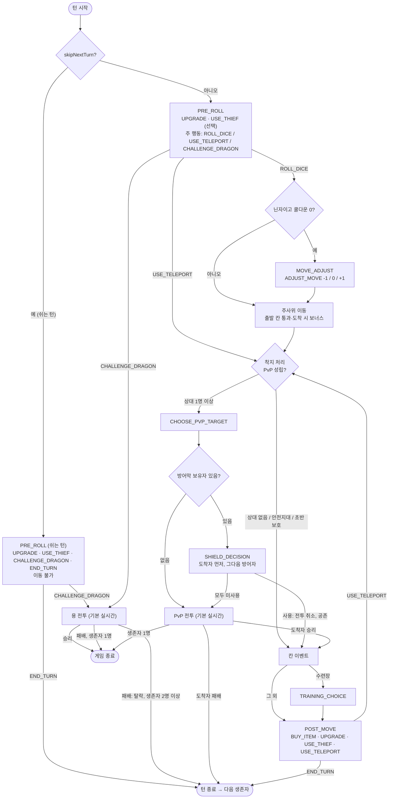

# 게임 기획서 — 드래곤 러쉬 (Dragon Rush)

> 상태: **구현·실측 반영**. 이 문서는 **게임 규칙·수치의 정본**이다. 엔진의 `DEFAULT_RULES`(`RulesConfig`)는 이 문서와 같아야 하며, 일치 여부는 골든 테스트로 보장한다.
> 관련 문서: 구조·멀티플레이 프로토콜 [architecture.md](architecture.md) · 관측/행동/보상/학습 env [ai-interface-spec.md](ai-interface-spec.md) · 일정·결정 [development-plan.md](development-plan.md)
> 현재 기본 보드 수치는 **`rush-3`**(2026-11-12)다. §15에는 현재 모델 적용 후 실측과 분포 수집 시점의 실측을 각각 기록한다. 그 아래 `rush-2`·`rush-1`·`final-1` 수치는 과거 기준이다. **(승인됨)** 표시는 사용자가 승인한 보호 규칙이다(§16).

## 1. 개요
| 항목 | 내용 |
|---|---|
| 이름 | 드래곤 러쉬 (Dragon Rush) |
| 장르 | 웹 턴제 주사위 보드게임 + 경량 RPG(성장·1:1 결투·보스) |
| 인원 | 2~4명. 사람·봇·사용자 AI 모델을 자유롭게 조합 |
| 플레이 모드 | 로컬 핫시트, vs AI, 온라인 멀티플레이 (§13) |
| 예상 플레이 시간 | `rush-3` 현재 내장 결과 모델을 사용하는 4인 휴리스틱 8,000판 실제 60Hz 전투 sim: 평균 5.90(중앙 6)/p95 9라운드. 실측 전투 틱에 보드 턴당 10초를 더한 추정치는 평균 4.15분이며 사람의 실제 선택 시간은 미계측이다(§15) |

| # | 디자인 기둥 | 규칙에서 구현되는 방식 |
|---|---|---|
| 1 | **언제 용에 도전할 것인가** | 코인으로 강해지는 성장과 용 도전의 결단. 지면 즉시 탈락하므로 "충분히 강해진 때"를 스스로 판단해야 한다 |
| 2 | **같은 칸 = 1:1 결투** | 위치가 곧 위협이 된다. 방어막·텔레포트·닌자 보정으로 결투를 피하거나 사냥한다 |
| 3 | **공개 정보·결정적 규칙** | 스탯·코인·아이템이 모두 공개되고, 비공개는 RNG 상태뿐이다. 사람·봇·학습 AI가 같은 규칙과 같은 정보로 겨룬다 |

## 2. 승리 조건 / 탈락
| 종류 | 조건 | 결과 |
|---|---|---|
| 용 처치 | 자기 턴에 `CHALLENGE_DRAGON`으로 용 전투에 승리 | 즉시 승리하고 게임 종료 (다른 생존자가 있어도) |
| 최후 생존 | 생존자가 1명이 됨 | 그 1명이 즉시 승리 (남의 턴에 방어하다 이겨도) |
| 무승부 | `maxRounds` 라운드가 끝남 | 생존자 전원 무승부. 사람 게임은 기본 꺼짐(방 옵션), 학습 env는 기본 100 |

| 탈락 원인 | 처리 |
|---|---|
| PvP 패배 | 즉시 탈락. 승자가 패자 코인의 절반(내림)과 아이템 전부, 추가 코인 30을 받고 HP를 최대치로 회복한다. 패자 코인의 나머지는 소멸 |
| 용 전투 패배 | 즉시 탈락. 코인과 아이템은 **소멸**한다(누구에게도 가지 않음) |

- 칸·카드 이벤트로는 죽지 않는다(HP 최소 1). 사망은 PvP와 용 전투에서만 일어난다.
- 탈락자는 보드에서 제거되고, 남은 게임은 관전한다.

## 3. 게임 준비
1. **좌석 구성**: 2~4석. 각 좌석은 사람, 봇, 모델 중 하나다.
2. **직업 선택**: 게임 시작 전에 고르며 **중복은 불가**하다(5직업 중 인원수만큼).
3. **턴 순서**: 게임을 만들 때 시드로 섞고, 섞인 순서대로 좌석 번호 0..n-1을 다시 매긴다. 이 순서는 게임 내내 고정된다.

| 시작 상태 | 값 |
|---|---|
| 위치 | 전원 0번(출발) 칸 |
| `hp` / `maxHp` / `atk` / `def` | 직업 기본값 (HP 가득 참) |
| `coins` | 10 |
| 아이템 | 없음 (`startingItems = {}`) |
| 강화 레벨 | `atk`·`def`·`maxHp` 모두 0 |
| 패시브 상태 | 검사 불굴 미사용, 닌자 쿨다운 0, `skipNextTurn` 없음 |
| 라운드 | 1부터 시작. **라운드 1~2는 초반 보호**(PvP 없음) (승인됨, §16 R1) |

## 4. 스탯과 직업
| 스탯 | 식별자 | 설명 |
|---|---|---|
| 최대 체력 | `maxHp` | HP 상한. 체력 강화(+6)와 거인의 축복(+5)으로 오른다 |
| 현재 체력 | `hp` | 전투와 이벤트 피해가 누적된다. 출발 보너스·약초·샘·여관·카드로 회복하고, PvP 승리 직후에는 최대치로 완전 회복한다. 회복량은 `maxHp`에서 잘린다 |
| 공격력 | `atk` | 1회 피해 = `max(1, atk + 1d6 − 상대 def)` |
| 방어력 | `def` | 받는 피해를 줄인다. 최소 피해 1은 막지 못한다 |
| 코인 | `coins` | 강화와 아이템 비용으로 쓴다. 0 아래로 내려가지 않는다 |
| 강화 레벨 | 스탯별 | 강화 비용 계산에만 쓴다. 유료 강화와 수련장으로만 오른다 |

| 직업 | id | HP | ATK | DEF | 패시브 | 플레이 스타일 |
|---|---|---|---|---|---|---|
| 검사 | `swordsman` | 53 | 5 | 5 | **불굴** | 체력이 가장 두꺼운 정면 승부형. 한 번 더 버티는 보험 덕분에 결투와 용 도전이 안정적이다 |
| 궁수 | `archer` | 39 | 6 | 6 | **선제 사격** | 언제나 먼저 쏘는 사냥꾼. 짧은 결투와 약해진 상대 저격에 강하다 |
| 마법사 | `mage` | 40 | 4 | 5 | **마력 관통** | 방어력이 높은 상대와 용에게 강하다. 공격력 강화 효율이 가장 좋다 |
| 닌자 | `ninja` | 34 | 4 | 5 | **그림자 걸음 + 회피** | 칸을 골라 밟으며 경제를 굴리고 결투는 피하는 기동·경제형 |
| 광전사 | `berserker` | 47 | 5 | 5 | **광폭화** | 맞을수록 강해지는 역전형 탱커 |

기본 `atk` ≤ `def`와 아래 시작 스탯은 B 상성 보정 뒤에도 유지했다. 다음 패시브의 주사위·선공·피해 세부 계산은 **선택형 빠른 전투** 규칙이다. 기본 실시간 전투의 기술·회피·상성은 [combat-design.md §5](combat-design.md)가 정본이다.

| 패시브 | 상세 규칙 |
|---|---|
| 불굴 (검사) | 게임당 1회 자동 발동. 피격으로 `hp`가 0 이하가 될 때 HP 1로 버틴다. PvP·용 모두 적용되고, 사용 여부는 공개 정보다 |
| 선제 사격 (궁수) | 모든 전투(공격·방어·용전)에서 항상 선공하고, 그 전투의 첫 공격 피해에 +3 (최소 피해 1을 적용한 뒤 더함) |
| 마력 관통 (마법사) | 공격할 때 상대 `def`를 `floor(def / 2)`로 계산한다. 보드 용 프로필에는 DEF 10 → 5가 적용된다 |
| 그림자 걸음 (닌자) | 주사위를 굴린 뒤 −1/0/+1 중 하나를 고른다. 최종 이동은 1~7이며, 주사위가 1이면 −1은 고를 수 없다. **±1을 쓰면 쿨다운 4**가 걸린다. 쿨다운은 자기 턴이 시작될 때마다 1씩 줄고(쉬는 턴 포함) 0일 때만 보정할 수 있다. 결과적으로 이후 여러 자기 턴에 걸쳐 사용할 수 없다. 쿨다운 중에는 `MOVE_ADJUST` 단계를 건너뛰고, 0을 고르면 쿨다운이 걸리지 않는다. 텔레포트에는 적용되지 않는다 (쿨다운은 승인됨, §16 R5b) |
| 회피 (닌자) | 피격마다 1/8 확률(1d8 = 1)로 피해가 0이 된다. 브레스와 궁수의 첫 사격을 포함한 모든 피격에 적용된다 |
| 광폭화 (광전사) | 공격할 때마다 판정한다. `2·hp ≤ maxHp`이면 `atk_eff = floor(atk × 1.3)`이며, 정수 연산 `floor(atk × 13 / 10)`으로 계산한다. 전투 도중에도 발동한다 |

## 5. 보드
24칸 순환 링(0~23, 시계 방향)이며 코너는 0/6/12/18이다. 이동은 주사위 1개(1d6)로 한다. 칸 이벤트는 고정 배치다.

| # | id | 이름 | 분류 | 효과 |
|---|---|---|---|---|
| 0 | `START` | 출발 | 특수 | **안전지대**(PvP 없음, 여러 명 공존). 주사위 이동으로 통과하거나 도착하면 **코인 +35, HP +6** |
| 1 | `GOBLIN` | 고블린 무리 처치 | 좋음 | 코인 +6 (원문 예시 값 +3의 2배, `rush-1`) |
| 2 | `POISON_SWAMP` | 독 늪 | 나쁨 | HP −5 |
| 3 | `TREASURE` | 보물 상자 | 좋음 | 코인 +12 |
| 4 | `BANDIT` | 산적의 습격 | 나쁨 | 코인 −4 |
| 5 | `TRAINING` | 수련장 | 좋음 | 원하는 스탯 1단계 무료 강화(`TRAINING_CHOICE`, 레벨 +1) |
| 6 | `SHOP` | 상점 | 특수 | 아이템 구매 |
| 7 | `WOLF` | 늑대 무리 처치 | 좋음 | 코인 +10, HP −3 |
| 8 | `TRAP` | 가시 함정 | 나쁨 | HP −6 |
| 9 | `HERB` | 약초 군락 | 좋음 | HP +8 |
| 10 | `PICKPOCKET` | 소매치기 | 나쁨 | 코인 −6 |
| 11 | `BLACKSMITH` | 대장장이의 축복 | 좋음 | `def` +1 (레벨 불변) |
| 12 | `INN` | 여관 | 좋음 | HP +20 |
| 13 | `ORC` | 오크 전사 처치 | 좋음 | 코인 +12, HP −4 |
| 14 | `CURSED_ALTAR` | 저주받은 제단 | 나쁨 | 코인 −6 |
| 15 | `FOUNTAIN` | 행운의 샘 | 좋음 | 코인 +6, HP +6 |
| 16 | `ROCKFALL` | 낙석 | 나쁨 | HP −5 |
| 17 | `MYSTERY` | 미지의 동굴 | 특수 | 동굴 카드 1장 |
| 18 | `SHOP` | 상점 | 특수 | 아이템 구매 |
| 19 | `TROLL` | 트롤 처치 | 좋음 | 코인 +16, HP −7 |
| 20 | `SPIDER_WEB` | 거미줄 늪 | 나쁨 | 다음 자기 턴 1회 쉼 |
| 21 | `WANDERING_MERCHANT` | 떠돌이 상인 | 좋음 | 무작위 아이템 1개 (3종 균등) |
| 22 | `STORM` | 폭풍 | 나쁨 | 코인 −2, HP −3 |
| 23 | `MYSTERY` | 미지의 동굴 | 특수 | 동굴 카드 1장 |

좋음 11칸, 나쁨 8칸, 특수 5칸이다. 이벤트 피해로는 HP가 1 아래로, 코인이 0 아래로 내려가지 않는다.

배치도 (7×7 테두리 링). 윗줄은 왼쪽→오른쪽, 오른쪽 줄은 위→아래, 아랫줄은 오른쪽→왼쪽, 왼쪽 줄은 아래→위로 진행한다. 약어는 id 앞 글자다.
```
[00 STRT][01 GOBL][02 POIS][03 TRES][04 BAND][05 TRNG][06 SHOP]
[23 MYST]                                             [07 WOLF]
[22 STRM]                                             [08 TRAP]
[21 MRCH]                 DRAGON LAIR                 [09 HERB]
[20 WEB ]              (CHALLENGE_DRAGON)             [10 PICK]
[19 TROL]                                             [11 SMTH]
[18 SHOP][17 MYST][16 ROCK][15 FOUN][14 ALTR][13 ORC ][12 INN ]
```

**미지의 동굴 카드 덱** (10장). 뽑을 때마다 10장 중 균등하게 1장을 뽑는 복원 추출이다(덱 상태와 숨은 정보가 없다). 모든 효과는 자동이며, 이동이나 전투를 일으키는 카드는 없다.

| id | 이름 | 분류 | 효과 |
|---|---|---|---|
| `HIDDEN_GOLD` | 숨겨진 금화 | 좋음 | 코인 +12 |
| `GEM_VEIN` | 보석 광맥 | 좋음 | 코인 +8 |
| `ANCIENT_RELIC` | 고대 유물 | 좋음 | `atk` +1 (레벨 불변) |
| `HEALING_SPRING` | 치유의 샘물 | 좋음 | HP +15 |
| `GIANT_BLESSING` | 거인의 축복 | 좋음 | `maxHp` +5 (`hp`도 +5, 레벨 불변) |
| `LOST_BAG` | 잃어버린 가방 | 좋음 | 무작위 아이템 1개 (3종 균등) |
| `CAVE_IN` | 동굴 붕괴 | 나쁨 | HP −7 |
| `GOBLIN_TRICK` | 도깨비 장난 | 나쁨 | 코인 −6 |
| `BAT_SWARM` | 박쥐 떼 | 나쁨 | 코인 −4, HP −3 |
| `LOST_IN_DARK` | 어둠 속 길 잃음 | 나쁨 | 다음 자기 턴 1회 쉼 |

## 6. 턴 진행
1. **턴 시작**: 닌자 쿨다운이 1 줄어든다. `skipNextTurn`이면 이번 턴은 **쉬는 턴**이다. 이동(주사위·텔레포트)만 불가하고, `PRE_ROLL`에서 강화·도둑·용 도전 또는 `END_TURN`을 할 수 있다. `skipNextTurn`은 턴이 끝날 때 소모된다(`TurnSkipped`).
2. **`PRE_ROLL`**: 강화와 도둑을 자유롭게 쓴 뒤 **주 행동 1개**를 고른다. 주사위(`ROLL_DICE`), 텔레포트(`USE_TELEPORT`), 용 도전(`CHALLENGE_DRAGON`) 중 하나다. 쉬는 턴이 아니면 이동 없이 턴을 넘길 수는 없다.
3. **`MOVE_ADJUST`** (닌자, 쿨다운 0일 때만): 주사위 결과에 −1/0/+1을 적용한다.
4. **이동**: 주사위 이동이 출발 칸을 지나거나 출발 칸에 도착하면(`위치 + 이동 칸 수 ≥ 24`) 출발 보너스를 1회 받는다. 텔레포트에는 보너스가 없다.
5. **착지 처리** (주사위 착지와 텔레포트 착지가 같다). 순서는 고정이다.
   1. PvP 판정: 안전지대이거나 초반 보호 중이거나 생존 상대가 없으면 4번(칸 이벤트)으로 건너뛴다. 상대가 1명이어도 `CHOOSE_PVP_TARGET`에서 결투 시작을 확인하고, 2명 이상이면 대상을 고른다. 1명일 때도 이 결정을 자동 적용하지 않는다.
   2. `SHIELD_DECISION`: 방어막을 가진 사람에게만 묻는다. 도착자가 먼저 정하고, 도착자가 쓰지 않으면 방어자가 정한다. 누가 쓰든 전투는 취소되고 두 사람은 그 칸에 공존한다.
   3. 전투(기본 60Hz 실시간, 선택형 빠른 전투는 주사위 즉시 판정) → 패자 탈락 → 전리품 이전 → 승자 코인 +30 및 HP 최대치 회복. **도착자가 지면 여기서 턴이 끝난다.**
   4. 칸 이벤트(도착자에게만 적용). 수련장이면 `TRAINING_CHOICE`를 거친다. 상점이면 구매 가능(`canBuy`)이 켜진다.
6. **`POST_MOVE`**: 구매·강화·도둑·텔레포트를 쓴 뒤 `END_TURN`. 텔레포트를 쓰면 5단계(착지 처리)를 다시 거쳐 `POST_MOVE`로 돌아온다.



| phase | 결정자 | 가능한 행동 | 비고 |
|---|---|---|---|
| `PRE_ROLL` | 턴 플레이어 | `UPGRADE{stat}` (반복 가능), `USE_THIEF{target}` (턴당 1회) + 주 행동 `ROLL_DICE` / `USE_TELEPORT{tile}` / `CHALLENGE_DRAGON` | `END_TURN`은 쉬는 턴에만 있다(그때는 `ROLL_DICE`·`USE_TELEPORT`가 없다). 텔레포트를 쓰면 그 턴에는 주사위도 용 도전도 없다 |
| `MOVE_ADJUST` | 닌자 | `ADJUST_MOVE{delta: -1, 0, +1}` | 쿨다운 중이면 단계를 생략한다. 주사위가 1이면 −1 불가 |
| `CHOOSE_PVP_TARGET` | 도착자 | `CHOOSE_PVP_TARGET{target}` | 비안전 칸에 생존 상대가 1명 이상일 때. 1명일 때도 결투 시작 확인을 위해 대기 |
| `SHIELD_DECISION` | 도착자 → 방어자 | `SHIELD_DECISION{use}` | 보유자에게만 묻는다. 방어자 차례가 유일한 비턴 결정이다 |
| `TRAINING_CHOICE` | 도착자 | `CHOOSE_TRAINING_STAT{stat: atk, def, maxHp}` | 거부할 수 없다 |
| `POST_MOVE` | 턴 플레이어 | `BUY_ITEM{item}` (`canBuy`일 때), `UPGRADE{stat}`, `USE_THIEF{target}`, `USE_TELEPORT{tile}`, `END_TURN` | 텔레포트를 쓰면 착지 처리 후 다시 `POST_MOVE` |

- 비용이 드는 행동은 코인이 충분할 때만 할 수 있다. 이동·칸 이벤트·턴 시작·종료는 엔진이 자동으로 진행한다. 실시간 전투는 외부 셸이 진행하고 엔진이 결과를 검증해 `GameEvent`로 기록한다.
- **합법 행동이 정확히 1개인 결정은 자동으로 적용된다**(예: 상점 밖에서 코인과 아이템이 없어 `POST_MOVE`에 `END_TURN`만 남은 경우). 단, 상대가 1명인 `CHOOSE_PVP_TARGET`은 결투 확인을 위해, 상점 방문 중인 `POST_MOVE`는 코인이 없어도 상점 표시를 위해 자동 적용하지 않는다.

## 7. 경제
| 구분 | 출처 | 양 |
|---|---|---|
| 획득 | 시작 / 출발 보너스 | 10 / 주사위 이동으로 통과·도착할 때마다 +35 (HP +6도 함께) |
| 획득 | 좋은 칸 | 고블린 +6, 늑대 +10, 보물 +12, 오크 +12, 샘 +6, 트롤 +16 |
| 획득 | 동굴 카드 | 숨겨진 금화 +12, 보석 광맥 +8 |
| 획득 | PvP 승리 보너스 | 코인 +30 (전리품과 별도), HP 최대치 회복 |
| 이전 | 도둑 / PvP 승리 | 상대에게서 최대 10 / 패자 코인의 절반(내림) |
| 손실 | 나쁜 칸 / 동굴 카드 | 산적 −4, 소매치기 −6, 제단 −6, 폭풍 −2 / 도깨비 장난 −6, 박쥐 떼 −4 |
| 소비 | 스탯 강화 / 아이템 | 아래 표 / 텔레포트 6, 방어막 6, 도둑 5 |
| 소멸 | 탈락 | PvP 패자 코인 중 승자에게 가지 않은 나머지, 용 패배자의 코인 전부 |

변경 전 `rush-2`의 4인 실제 전투 시뮬에서 턴당 순 코인 유입은 약 5.56이었다(§15). `rush-3`의 PvP 승리 보너스와 3번 보물 상자 배치는 이 지표에 반영되지 않았다. `rush-1`에서 출발 보너스를 +20→+35로 올렸고, 나머지 칸·카드·아이템 가격은 유지했다.

**스탯 강화**: 자기 턴의 `PRE_ROLL`·`POST_MOVE`이면 위치와 상관없이 할 수 있다. 비용은 `기본비용 + 해당 스탯 레벨 × 1`이다.

| 스탯 | 효과 | 비용식 | 1회째 | 2 | 3 | 4 | 5 | 5회 누적 | 10회 누적 |
|---|---|---|---|---|---|---|---|---|---|
| `atk` | +1 | 3 + lvl | 3 | 4 | 5 | 6 | 7 | 25 | 75 |
| `def` | +1 | 2 + lvl | 2 | 3 | 4 | 5 | 6 | 20 | 65 |
| `maxHp` | 최대 HP +6, 현재 HP +6 | 2 + lvl | 2 | 3 | 4 | 5 | 6 | 20 | 65 |

레벨은 스탯별로 따로 센다. 수련장 무료 강화는 레벨을 1 올리고(다음 비용 증가), 대장장이·고대 유물·거인의 축복은 레벨을 바꾸지 않는다. 스탯 상한은 없으며 점증 비용이 제동 역할을 한다.

## 8. 아이템
| 아이템 | id | 가격 | 효과 | 사용 시점 |
|---|---|---|---|---|
| 텔레포트 | `teleport` | 6 | 현재 칸을 제외한 23칸 중 원하는 칸으로 즉시 이동한다. 도착 칸에서 일반 착지 처리(PvP·칸 이벤트)를 한다. 출발 보너스는 없다 | 자기 턴의 `PRE_ROLL`(주사위 대신 이동)과 `POST_MOVE`(추가 이동). **턴당 횟수 제한 없음**(보유한 만큼) |
| 방어막 | `shield` | 6 | PvP가 성립했을 때 1개를 소모해 전투를 취소하고, 두 사람이 공존한다 | 반응형: `SHIELD_DECISION`에서 도착자가 먼저, 그다음 방어자가 정한다. 용 전투에는 쓸 수 없다 |
| 도둑 | `thief` | 5 | 코인이 1 이상인 생존 상대 1명을 지정해 `min(10, 상대 코인)`을 가져온다. 코인이 0인 상대는 지정할 수 없다. 위치와 상관없다 | 자기 턴의 `PRE_ROLL`·`POST_MOVE`, **턴당 1회**. 지정할 수 있는 상대(코인 ≥ 1)가 없으면 쓸 수 없다 |

- 모든 아이템은 일회용이고 보유 개수에 제한이 없다. 판매나 양도는 할 수 없다.
- **얻는 방법**: 상점 구매, 떠돌이 상인과 잃어버린 가방(3종 균등 무작위), PvP 승리 전리품. 시작 아이템은 없다.
- **구매 조건**: 이번 턴에 가장 최근에 도착한 칸이 상점일 때만(`canBuy`) 살 수 있다. 한 번 방문해 여러 개를 사도 되고, 같은 종류를 중복 구매해도 된다(재고 무한). 턴을 상점 칸에서 시작한 것은 도착이 아니다. 다른 칸으로 이동하면 `canBuy`가 꺼지고, 텔레포트로 다른 상점에 도착하면 새 방문이 된다.
- **즉시 사용**: 아이템은 얻는 즉시 보유한다. 턴 플레이어는 얻은 그 턴에도 쓸 수 있다(텔레포트는 원문 요구사항). 방어자가 전리품으로 얻은 경우 방어막은 즉시, 텔레포트와 도둑은 다음 자기 턴부터 쓸 수 있다.

## 9. 전투
PvP(`duel`)와 용전(`dragonFight`)은 기본적으로 60Hz 실시간 탑다운 전투다. 보드 엔진이 `COMBAT` 단계에서 멈추면 셸이 직업·현재/최대 HP·ATK·DEF·불굴 가능 여부를 전투 setup에 옮긴다. 승패와 남은 HP·불굴 사용 결과를 `applyCombatResult`로 보드에 기록한다. 패자는 탈락한다. PvP 승자만 추가 코인 30을 받고 HP가 최대치로 회복된다. 용 처치 승리는 보상 없이 즉시 게임을 종료한다. 실제 동작과 상성 실측은 [combat-design.md](combat-design.md)의 `DEFAULT_COMBAT_RULES`가 정본이다.

로컬에서는 브라우저에서 전투를 진행한다. 온라인에서는 서버가 전투 입력과 결과를 확정하고 클라이언트가 입력을 예측·롤백한다. 용전·PvP는 게임 내에서 직접 조작하며, 봇 전투원은 스크립트 정책이 대신 조작한다. 방어막을 쓰면 전투가 시작되지 않는다. 직업 시작 스탯은 B 상성 실측 때와 동일하다.

**선택형 빠른 전투**(`combat.mode = "dice"`)에서만 엔진이 주사위로 즉시 판정한다. 이 모드의 피해는 `max(1, atk_eff + 1d6 − def_eff)`이고, 궁수 첫 공격 +3·닌자 1d8 회피·검사 불굴·광전사 광폭화·마법사 DEF 절반이 적용된다. 100교환 상한에 닿으면 PvP는 남은 HP 비율, 용전은 도전자 패배로 정리한다. 이 규칙과 실시간 전투의 피해·기술·시간 제한은 서로 다르다.

## 10. 용
| 항목 | 값 |
|---|---|
| 보드 프로필 | HP **88**, ATK **10**, DEF **10** (`rush-3`, `rush-2`에서 유지) |
| 도전 | 자기 턴 `PRE_ROLL`의 주 행동. 위치·라운드·스탯 조건은 없고 쉬는 턴에도 가능 |
| 전투 | 기본 60Hz 용전. `boardCombatSetup`이 보드 프로필을 전달하며 전투 기술·피해·시간 제한은 `DEFAULT_COMBAT_RULES`가 정본 |
| 빠른 전투 | 선택했을 때만 주사위 즉시 판정. 용의 3·6·9…번째 공격은 방어력을 무시 |
| 결과 | 승리 시 PvP 보상 없이 즉시 게임 종료. 패배 시 즉시 탈락하며 코인·아이템 소멸. 방어막은 사용 불가 |

실제 전투로 측정한 4인 보드 경기의 용 처치 종료 비중은 61.3%, 도전 성공률은 34.3%다(§15). 이는 봇·전투 정책을 고정한 시뮬레이션 결과이며 특정 플레이어의 승률 안내가 아니다. `outcome_v1`은 봇 의사결정과 보드 학습 env 내부에만 쓰고 인게임에 예측치를 표시하지 않는다.

## 11. PvP 보상과 탈락 처리
| 항목 | 규칙 |
|---|---|
| 전리품 | 승자는 `floor(패자 코인 / 2)`와 패자 아이템 전부(개수 제한 없음)를 받는다. 나머지 코인은 소멸한다 |
| 승리 보너스 | 전리품과 별개로 코인 +30을 받고, 전투 후 HP를 `maxHp`까지 완전 회복한다. 도착자 승리 시 이후 칸 이벤트는 정상 적용한다 |
| 승자 상태 | 불굴 사용 여부 같은 개인 상태는 이전되지 않는다 |
| 좌석 | 탈락자의 좌석 번호와 상대 좌석 순서는 고정된다(재정렬 없음). 탈락 좌석은 턴에서 건너뛰고, 대상으로 지정할 수 없다 |
| 진행 중인 턴 | 턴 플레이어가 탈락하면(PvP 도착자 패배, 용 패배) 그 즉시 턴이 끝난다. 방어자가 탈락하면 턴 플레이어의 턴은 계속된다(칸 이벤트 → `POST_MOVE`) |
| 승리 판정 | 모든 전투 직후 즉시 판정한다. 전투는 항상 1명만 탈락시키므로 동시 탈락이나 전원 탈락은 없다 |

## 12. 엣지 케이스 규칙
| 상황 | 판정 |
|---|---|
| 게임 시작 때 0번에서 떠남 | 통과가 아니므로 보너스가 없다 |
| 0번에 정확히 도착(주사위) | 보너스 1회. 한 번의 이동에서 보너스를 2회 받는 일은 없다. 보너스는 PvP·칸 이벤트보다 먼저 적용된다 |
| 텔레포트로 0번을 지나거나 0번에 도착 | 보너스 없음. 0번이면 안전지대 효과만 적용된다 |
| 쉬는 턴(거미줄 늪, 어둠 속 길 잃음) | 다음 자기 턴에는 이동(주사위·텔레포트)만 할 수 없다. `PRE_ROLL`에서 강화·도둑·용 도전 또는 `END_TURN`은 가능하다(원문 "용은 언제든 자신의 턴에 도전", 답변 "강화는 자기 턴이면 어디서나" 준수). 중첩되지 않으며, 텔레포트로 도착해도 적용된다. 쉬는 중에도 남의 턴의 방어막 질의에는 응답한다. 라운드와 닌자 쿨다운에서는 1턴으로 센다 |
| 지나간 칸에 있는 상대 | 충돌하지 않는다. PvP는 턴 플레이어의 이동(주사위·텔레포트)이 끝난 칸에서만 성립한다 |
| 공존 중인 칸(2명 이상)에 도착 | `CHOOSE_PVP_TARGET`으로 1명만 고른다. 착지 1회에 PvP는 최대 1회이고, 나머지와는 공존한다(전투는 항상 1:1) |
| 방어막으로 공존한 두 사람 | 자동으로 다시 싸우지 않는다. 한쪽이 떠났다가 다시 도착하면 새 충돌로 처리하고 방어막을 다시 묻는다 |
| 상대가 1명인 착지 | `CHOOSE_PVP_TARGET`에서 결투 시작을 명시적으로 확인한다. 안전지대·라운드 1~2 보호 중에는 이 결정을 만들지 않는다 |
| 초반 보호(라운드 1~2) | 같은 칸에 멈춰도 PvP 없이 공존하고 칸 이벤트만 적용된다. 라운드 3부터 정상 규칙이다 (승인됨, §16 R1) |
| 방어막 질의 | 대상이 정해진 뒤 진행한다. 도착자가 쓰면 방어자에게는 묻지 않는다. 취소 1회에 1개만 소모된다. 텔레포트로 일부러 공격한 경우도 같다. 취소된 뒤 대상을 바꿀 수 없다 |
| 착지 직후 전투 전에 강화나 구매 | 불가. 착지 처리 중 결정은 `CHOOSE_PVP_TARGET`·`SHIELD_DECISION`·`TRAINING_CHOICE`뿐이다. 대비는 미리 해야 한다 |
| 칸 이벤트의 적용 대상 | 도착자에게만 적용되고, 방어자와 공존자에게는 적용되지 않는다 |
| 텔레포트 목적지 | 현재 칸만 빼고 모두 가능하다(같은 칸 이벤트를 반복 발동하는 것 방지) |
| 텔레포트 → 상점 → 텔레포트 구매 → 재사용 | 가능하다(턴당 제한 없음). 쉬는 턴, 남의 턴, 착지 처리 중에는 쓸 수 없다 |
| 도둑 반복 | 턴당 1회만 쓸 수 있다(상점에서 사서 쓰고 다시 사는 루프 방지, §16 R3 확인 필요) |
| 이벤트 피해·손실이 남은 값보다 큼 | HP는 1에서, 코인은 0에서 멈춘다. 빚은 없다 |
| 회피와 불굴이 겹침 | 회피에 성공하면 불굴은 소모되지 않는다 |
| 광폭화 판정 시점 | 공격할 때마다 그 순간의 HP로 판정한다(전투 중 발동) |
| 마지막 2인 중 1명이 용에 실패 | 남은 1명이 즉시 최후 생존 승리 |
| 방어자가 이겨 최후 생존자가 됨 | 남의 턴이어도 즉시 승리하고 게임이 끝난다 |
| 라운드 집계 | 턴 순서가 한 바퀴 돌아 처음으로 돌아올 때 +1(탈락 좌석은 건너뜀) |
| `maxRounds` 도달 | 마지막 라운드의 마지막 턴이 끝나는 순간 생존자 전원 무승부 |

## 13. 게임 모드
| 모드 | 구성 | 실행 위치 | 비고 |
|---|---|---|---|
| 로컬 핫시트 | 한 화면에서 2~4명의 사람(봇 섞기 가능) | 브라우저 (서버 불필요) | 타이머 없음. 방어자 결정은 "○○님의 결정" 화면으로 넘긴다(공개 정보라 화면 가림 없음) |
| vs AI | 좌석별로 사람 / 봇(`RandomBot`, `HeuristicBot`) / 모델(`ModelPolicy`) | 로컬은 브라우저, 온라인은 서버 | 모델 = 사용자가 제공한 Actor-Critic 가중치 JSON을 어댑터로 읽는다. **JSON 포맷을 받기 전까지 모델 좌석은 "준비 중"으로 비활성화된다** |
| 온라인 멀티플레이 | 방 코드로 모인 2~4석 (사람·봇·모델) | 서버 권위 | 아래 상세 |
| AI 학습 환경 | 화면 없는 대량 대전, Python에서 `reset()`/`step()` 호출 | Node env 서버 + Python 클라이언트(numpy만 사용) | 단일 에이전트 또는 셀프플레이. 기본 `maxRounds` 100. 보상은 승리 +1 / 패배 −1 / 무승부 0. 트레이너는 사용자 담당 |

**온라인 상세**
- **방**: 6자리 방 코드, 닉네임(계정 없음), 호스트가 좌석(사람/봇/모델/빈 좌석)을 설정한다. 직업 선택은 중복 불가이고 준비 상태를 표시한다. 2석 이상이고 사람 전원이 준비되면 호스트가 시작한다. 호스트가 나가면 다음 접속자에게 호스트가 넘어간다.
- **결정 권한**: 한 번에 결정 하나만 대기한다. 그 결정자(방어막이면 방어자)만 행동을 보낼 수 있다. 누가 결정 중인지와 남은 시간은 전원에게 보인다.
- **타이머**: 사람 좌석의 모든 결정은 60초다(서버 설정 `TURN_TIMEOUT_MS`). 타이머는 (결정자, phase)가 바뀔 때만 새로 시작하므로, 강화를 반복해도 연장되지 않는다. 봇·모델 좌석에는 타이머가 없다. `maxRounds`는 호스트가 로비에서 정하는 방 옵션이다.

| 시간 초과 phase | 기본 행동 |
|---|---|
| `PRE_ROLL` / `POST_MOVE` | `ROLL_DICE` / `END_TURN` |
| `SHIELD_DECISION` | 사용 안 함 |
| 선택류 (`MOVE_ADJUST`·`CHOOSE_PVP_TARGET`·`TRAINING_CHOICE`) | `getLegalActions`의 첫 번째 합법 행동. 엔진의 합법 행동 순서가 고정되어 있어 각각 보정 0, 턴 순서상 도착자 다음 좌석부터 가장 가까운 대상, `atk`가 된다 |

- **재접속**: 연결이 끊기면 그 좌석의 결정은 즉시 `HeuristicBot`이 대신 내린다(방어막 결정 포함). 60초 안에 같은 브라우저(세션 토큰)로 돌아오면 다음 결정부터 제어권을 되찾는다. 60초를 넘기면 그 게임이 끝날 때까지 봇이 플레이하고, 돌아온 사람은 관전한다(확인 필요, §16 D5). 연속 3회 시간 초과도 연결 끊김처럼 봇이 대리하며, 그 사람이 아무 입력이나 하면 해제된다. 기권 행동은 없다.
- 기술 상세(프로토콜, 버전 검사, 서버 구조)는 [architecture.md](architecture.md), 관측/행동/보상/env API와 모델 통합 계약은 [ai-interface-spec.md](ai-interface-spec.md)를 따른다.

## 14. UI/UX 핵심 화면
| 화면 | 핵심 내용 |
|---|---|
| 홈 / 로비 | 모드 선택(로컬 핫시트, vs AI, 온라인 방 만들기·참가)과 닉네임·방 코드 입력. 대기실에는 좌석 카드(사람/봇/모델, 연결·준비 상태), 방 코드 복사, 호스트 시작 버튼이 있다 |
| 직업 선택 | 5직업 카드(스탯 막대와 패시브 한 줄). 이미 선택된 직업은 회색으로 잠긴다 |
| 게임 보드 | 가운데에 7×7 링 보드(칸 아이콘, 말 토큰, 중앙 용 둥지). 옆에 플레이어 패널(HP 바, ATK/DEF, 코인, 아이템 수, 쉼·불굴·쿨다운 아이콘). 아래에 행동 바(합법 행동만 활성화). 주사위 애니메이션, `GameEvent` 기반 게임 로그, 현재 결정자와 남은 시간 표시 |
| 상점 모달 | 상점에 도착하면 `POST_MOVE`에서 열린다. 3종 가격과 보유 수를 보여 주고, 여러 개를 연속으로 살 수 있다 |
| 강화 패널 | 자기 턴의 `PRE_ROLL`·`POST_MOVE`에서 언제든 연다. 다음 비용과 강화 후 수치를 미리 보여 준다 |
| 전투 연출 | 결투·용전 탑다운 전투 화면. 타격·회피·불굴·광폭화·용 기술을 보여 준다. 전투 전에는 필요할 때 방어막 결정 다이얼로그가 뜬다. 선택형 빠른 전투는 전투 화면 없이 즉시 판정한다 |
| 결과 화면 | 승자와 승리 유형(용 처치/최후 생존/무승부), 플레이어별 요약(탈락 라운드·원인), 다시 하기와 로비로 돌아가기 |

## 15. 밸런스 근거
### 현재 `rush-3` 모델을 사용하는 보드 봇 (4인, 실제 60Hz 전투)

`pnpm sim --games 8000 --players 4 --bots heuristic --seed 2026 --workers 4 --combat sim --outcome-model packages/ai/src/outcome/model.json --json`으로 측정했다. 전투 결과는 `outcome_v1` 샘플이 아닌 실제 60Hz sim이고, 내장 모델은 보드 봇의 용 도전·PvP 판단에 사용됐다. 라운드 1~2 PvP 보호는 유지했다.

| 지표 | 4인 (8,000판) |
|---|---:|
| 평균 라운드 (중앙값) / p95 | 5.90 (6) / 9 |
| 용 처치 종료 / 무승부 | 46.8% / 0% |
| 직업 승률 검/궁/마/닌/광 | 18.8/26.1/34.8/25.4/19.8% |
| 3라운드 안 좌석 탈락 | 22.6% |
| 용 도전 성공률 / 처치 평균 라운드 | 26.7% / 5.51 |
| 판당 PvP / 방어막 취소 | 0.94 / 0.38 |
| 판당 구매 텔레포트/방어막/도둑 | 0.14/1.00/0.31 |
| 판당 보드 턴 / 실제 전투 시간 | 18.59 / 62.96초 |
| 예상 판 시간 (보드 턴 10초 가정) | 4.15분 |

중앙 9~11라운드, 직업 승률 25±5%p, 3라운드 안 탈락 <5% 목표는 미달이다. 용 처치 종료 40~75%와 p95 ≤15는 통과한다. 이 결과는 보드 봇 정책과 모델의 상호작용을 포함하므로 아래 분포 수집 시점의 결과와 다르다.

### 현재 `rush-3` 모델을 사용하는 보드 봇 (3인·2인, 실제 60Hz 전투)

위 4인과 같은 기준 커밋 `a5fd724`의 내장 모델로 `pnpm sim --games 4000 --players 3 --bots heuristic --seed 2026 --workers 4 --combat sim --outcome-model packages/ai/src/outcome/model.json --json`을 실행하고, `--players 2`로도 실행했다. 각 인원 4,000판이며 전투는 `scripted:balanced`의 실제 60Hz sim으로 해결했다. 1 worker 재실행에서도 지표가 같았다. 직업 승률은 해당 직업이 배정된 좌석의 승률이고, 조기 탈락은 원인에 관계없이 3라운드 안 탈락한 좌석의 비율이다.

| 지표 | 3인 (4,000판) | 2인 (4,000판) |
|---|---:|---:|
| 평균 라운드 (중앙값) / p95 | 5.80 (6) / 9 | 5.05 (5) / 9 |
| 용 처치 종료 / 무승부 | 33.6% / 0% | 17.9% / 0% |
| 직업 승률 검/궁/마/닌/광 | 21.6/39.5/45.2/36.4/24.1% | 31.6/61.8/61.4/55.8/39.0% |
| 3라운드 안 좌석 탈락 | 19.4% | 14.6% |
| 용 도전 성공률 | 25.5% | 23.7% |
| 판당 PvP / 방어막 취소 | 0.58 / 0.22 | 0.24 / 0.09 |
| 판당 구매 텔레포트/방어막/도둑 | 0.14/0.68/0.29 | 0.16/0.33/0.19 |

두 인원 모두 용 처치 종료 40~75%와 3라운드 안 탈락 <5% 목표에 미달한다. 직업별 승률 편차도 크다. 이 값은 휴리스틱 보드 봇과 스크립트 전투 봇을 함께 사용한 결과다.

### `rush-3` 분포 수집 시점 (4인, 실제 60Hz 전투)

`pnpm sim --games 8000 --players 4 --bots heuristic --seed 2026 --workers 4 --combat sim --log-fights packages/sim/data/rush3_stat_dist_v1.json --json`으로 측정했다. 보드 봇은 당시 내장 `rush-2` outcome 모델의 버전 불일치 때문에 주사위 몬테카를로 추정으로 판단했다. 이 분포의 실제 전투는 매 틱 결정을 내리는 `scripted:balanced` 봇으로 해결했고, PvP 보호는 라운드 1~2에 유지했다. 새 `rush-3` 모델을 사용하는 보드 봇의 밸런스는 별도 재측정이 필요하다.

| 지표 | 4인 (8,000판) |
|---|---:|
| 평균 라운드 (중앙값) / p95 | 8.37 (8) / 14 |
| 용 처치 종료 / 무승부 | 56.8% / 0% |
| 직업 승률 검/궁/마/닌/광 | 26.5/19.8/20.7/33.7/24.2% |
| 3라운드 안 좌석 탈락 | 17.1% |
| 용 도전 성공률 / 처치 평균 라운드 | 61.2% / 8.85 |
| 판당 PvP / 방어막 취소 | 1.90 / 0.50 |
| 판당 구매 텔레포트/방어막/도둑 | 0.31/1.03/0.94 |
| 판당 보드 턴 / 실제 전투 시간 | 25.72 / 49.44초 |
| 예상 판 시간 (보드 턴 10초 가정) | 5.11분 |

2라운드 보호는 그대로여서 그 기간의 PvP 탈락은 없다. 3라운드 안 탈락 17.1%와 닌자 승률 33.7%는 설계 목표(각각 <5%, 25±5%p)를 벗어난다. 중앙 9~11라운드 목표도 중앙 8로 미달한다. 이 표는 `rush-3` 전투 스탯 분포를 수집한 시점의 측정 결과다.

### 이전 `rush-2` (역사적 기준)

아래 수치는 변경 전 `rush-2`를 실제 60Hz 전투 sim과 매 틱 입력을 결정하는 `scripted:balanced` 전투 봇으로 측정한 기록이다. `rush-3`에는 시작 방어막 제거, PvP 승리 보너스·완전 회복, 3·9번 칸 교체, 단일 대상 결투 확인이 반영되어 있으므로 아래 수치를 현재 밸런스로 읽으면 안 된다. 전투 학습 env의 `action_repeat=4`는 별도 계약이다. 보드 봇은 내장 `outcome_v1`으로 용 도전·PvP를 판단한다. `rush-2`에서는 직업 초기 HP/ATK/DEF, 시작 방어막 1개, PvP 보호 2라운드가 B 상성 보정 때와 동일했다. 변경한 공통 수치는 출발 코인 보너스 +20→+35, 용 DEF 6→10이며 닌자 이동 보정 쿨다운 2→4와 봇 용 도전 기준도 조정했다. 전투 정책 학습 가중치는 아직 없으므로 이 수치는 Normal 스크립트 봇 기준이다.

재현: `pnpm sim --games 8000 --players 4 --bots heuristic --seed 2026 --workers 4 --combat sim --outcome-model packages/ai/src/outcome/model.json --json`. 3인·2인은 같은 명령에 `--games 4000 --players '3,2'`를 사용했다. 아래의 탈락 비율은 **3라운드 안**이며, 승인된 2라운드 PvP 보호 때문에 2라운드 안 PvP 탈락은 0이다. 결과 모델은 혼합 보드 프로필의 분리 holdout에서 보정됐으며 최종 봇 도전 분포에서 별도 보정 통과를 보증하지 않는다.

| 지표 | 4인 (8,000판) | 3인 (4,000판) | 2인 (4,000판) |
|---|---:|---:|---:|
| 평균 라운드 (중앙값) / p95 | 7.67 (8) / 11 | 7.36 (7) / 11 | 6.47 (6) / 10 |
| 용 처치 종료 / 무승부 | 61.3% / 0% | 50.0% / 0% | 30.9% / 0% |
| 직업 승률 검/궁/마/닌/광 | 26.4/23.4/24.0/29.1/22.1% | 32.7/32.9/32.2/40.0/28.8% | 47.4/50.9/52.3/56.3/43.2% |
| 3라운드 안 좌석 탈락 | 3.1% | 2.7% | 2.1% |
| 용 도전 성공률 / 처치 평균 라운드 | 34.3% / 7.05 | 34.5% / 6.96 | 34.0% / 6.84 |
| 판당 PvP / 방어막 취소 | 0.63 / 1.60 | 0.30 / 0.92 | 0.09 / 0.36 |
| 판당 구매 텔레포트/방어막/도둑 | 0.39/0.08/0.42 | 0.31/0.05/0.25 | 0.22/0.02/0.09 |
| 판당 보드 턴 / 실제 전투 시간 | 25.51 / 56.6초 | 19.43 / 43.7초 | 12.38 / 26.2초 |
| 예상 판 시간 (보드 턴 10초 가정) | 5.19분 | 3.97분 | 2.50분 |

4인 목표 중 p95 ≤15, 용 처치 종료 40~75%, 직업 공정 승률 25±5%p, 2라운드 내 탈락 <5%는 이 표본에서 통과한다. **중앙 9~11라운드 목표는 8라운드로 미달**이다. 3인·2인은 더 짧고 직업 승률 편차가 크다. 2인의 용 처치 종료도 40% 아래다. 공통 수치만으로 4인과 소인원 목표를 동시에 달성했다고 주장하지 않는다.

예상 시간은 **실제 sim 전투 틱/60**과 보드 턴당 10초라는 가정을 합친 값이다. 보드 턴당 14초라면 4인 평균 약 6.90분이며 사람의 실제 선택 시간은 아직 계측하지 않았다. `pnpm sim`의 `seconds`는 CPU 실행 시간이다.

이전 `rush-1`은 주사위 판정 4인 20,000판에서 평균 10.2(중앙 10)/p95 15라운드, 용 처치 종료 87.5%였다. 현재 전투 방식과 봇 판단이 달라 직접 비교 가능한 실시간 기준선은 아니다. `combat-2` balanced 봇 반응 10f/16f 합산 10개 상성 **방향**은 통과했지만 목표 우세 강도는 미달이고 5f 일부 방향은 역전된다. UI Easy/Hard는 다른 스타일이다([combat-design.md §5.1](combat-design.md)).

### 기록: `final-1` (참고)
설계 단계 Python 프로토타입(`hero_sim.py`, config `final`)으로 정하고 P3에서 TS 엔진으로 재검증한 이전 기준이다(`pnpm sim --seed 2026`). 프로토타입은 저장소 밖 참고 자료이며, 저장소 보관 여부는 개발 계획서 D11에서 정한다. 목표는 4인 18~30라운드(p95 ≤ 60), 용 처치 40~70%, 3라운드 안 탈락 < 5%, 판당 PvP 1~4회(4인), 아이템별 판당 구매 ≥ 0.3이었다.

| # | 지표 | 4인 (20,000판) | 3인 (5,000판) | 2인 (5,000판) |
|---|---|---|---|---|
| 1 | 평균 라운드 (중앙값) / p95 | 23.5 (24) / 32 | 22.3 (23) / 31 | 19.1 (21) / 30 |
| 2 | 용 처치 비중 / 무승부 | 62.4% / 0% | 54.7% / 0% | 42.3% / 0% |
| 3 | 직업 승률 검/궁/마/닌/광 | 24.1/25.4/26.6/23.6/25.3 | 32.4/34.1/34.9/31.8/33.5 | 49.2/50.8/48.7/49.4/51.7 |
| 4 | 3라운드 안에 탈락한 비율 | 0.0% | 0.0% | 0.0% |
| 5 | 용 도전 성공률 / 처치 평균 라운드 | 72.9% / 24.7 | 71.9% / 24.5 | 73.0% / 23.7 |
| 6 | 판당 실제 PvP 전투 / 방어막 취소 | 1.94 / 3.18 | 1.14 / 2.02 | 0.42 / 0.90 |
| 7 | 판당 구매 tp / sh / th | 0.74 / 0.41 / 0.50 | 0.66 / 0.27 / 0.34 | 0.47 / 0.13 / 0.14 |
| 8 | 동일 스탯 선공 승률 (패시브 없는 미러) | 56.7~58.5% (목표 ≤ 60%) | ← | ← |
| 9 | 턴당 순 코인 | 2.43 | 2.48 | 2.53 |

- 무작위 정책(`random`) 좌석 승률: 4인 5.4%(공정 25%), 2인 18.6%(공정 50%). 결투에서 선공 승률은 69%, 교환 상한 도달은 0회다. 불변식(코인 ≥ 0, 1 ≤ HP ≤ maxHp, 보호 기간 중 PvP 0회) 1,500판 검사를 통과했다.
- v0 대비 주요 변경: 직업 HP를 크게 올리고 ATK를 DEF 이하로 낮췄다. 용 100/15/8 → 115/10/6, 출발 보너스 +3/+5 → +10/+6, 아이템 가격 8/5/4 → 6/6/5, DEF 강화 기본비용 3 → 2, HP 강화 +5 → +6, 닌자 회피 1/6 → 1/8, 광폭화 ×1.5 → ×1.3. 구조 변경 3건(초반 보호, 시작 방어막, 닌자 쿨다운)은 §16에서 확인한다. v0에서는 3라운드 안에 37.6%가 탈락했다.

**튜닝 원칙**
1. 모든 수치는 `RulesConfig` 한 곳에만 둔다. 초반 보호 `pvpGraceRounds = 2`, 시작 아이템 `startingItems = {}`, PvP 승리 보너스 `pvpWinBonusCoins = 30`, 닌자 쿨다운 4도 여기에 있다. 코드에 수치 리터럴을 하드코딩하지 않는다.
2. 수치나 규칙을 바꾸면 `RulesConfig.version`을 올리고, `pnpm sim`으로 위 지표를 다시 검증하고, 이 문서와 골든 테스트를 함께 갱신한다.
3. 보드 밸런스는 실제 `--combat sim`으로 측정한다. `outcome` 리졸버는 학습용 근사치로 별도 검증한다.

## 16. 확인 필요 사항
아래 기본값만으로도 이 문서의 규칙은 완결된다. 사용자가 다르게 결정하면 해당 수치를 `RulesConfig`에서 바꾸고 §15 지표를 다시 검증한다. ID는 개발 계획서 §2의 결정 번호와 같다(R6 밸런스 미달 수용 여부는 §15). R1·R5a·R5b는 원문 요구의 예외로 2026-11-11 승인되었으나, R5a는 `rush-3`에서 제거 요청으로 변경되었다.

| ID | 질문 | 현재 기본값 | 영향 |
|---|---|---|---|
| R1 | 초반 몇 라운드는 같은 칸이어도 싸우지 않는 **초반 보호**를 둘까요? (원문 "같은 칸이면 싸움"의 예외) | **승인됨**: 적용. `rush-1`에서 라운드 1~3 → 1~2(`pvpGraceRounds = 2`) | 빼면 전원이 0번에 몰려 출발하므로 초반 탈락이 급증한다(v0에서 3라운드 안 탈락 37.6%). `rush-1`(4인)에서 2라운드면 4라운드 안 탈락 6.7%, 3라운드면 1.2%이고, 3라운드로 늘리면 용 처치 비중은 87.5% → 91.3%, 판당 결투는 1.10 → 0.87이 된다 |
| R2 | **텔레포트를 한 턴에 여러 장** 쓸 수 있게 할까요? | 제한 없음(원문 "얻은 턴에도 사용 가능"을 그대로 따름) | 연쇄 습격이 가능해진다. 턴당 1회로 바꾸면 "이미 쓴 턴에 새로 얻은 카드는 다음 턴부터"라는 예외가 생긴다 |
| R3 | 도둑도 **일회용·턴당 1회**가 맞나요? (원문에는 일회용 표기가 없음) | 일회용, 턴당 1회 | 재사용이면 매 턴 10코인을 빼앗는 영구 효과가 되어 경제 전체를 다시 잡아야 한다 |
| R4 | 목표 **플레이 길이와 용 처치 비중** | 현재 모델 사용 `rush-3` 4인 실제 전투: 중앙 6 / p95 9라운드, 용 처치 종료 46.8% | 중앙 9~11 목표는 미달, p95·용 비중은 통과. 보드 턴당 10초 가정 평균 4.15분이며 실제 사람 턴 시간은 미계측. 3인·2인 현재 모델 실측은 §15에 있다 |
| R5a | 시작할 때 **방어막 1개**를 지급할까요? | `rush-3`: **지급 안 함** (`startingItems = {}`). 기존 승인은 2026-11-12 사용자 제거 요청으로 대체 | 오른쪽의 `final-1`·`rush-1` 수치는 과거 비교 자료이며 `rush-3`의 재측정 결과가 아니다. `rush-1`(4인)에서 빼면 용 처치 비중은 61.5%(보호 2라운드) / 68.3%(보호 3라운드)였고, 4라운드 안에 좌석의 26.0% / 14.6%가 탈락했다 |
| R5b | 닌자 그림자 걸음에 **쿨다운**을 둘까요? | **승인됨**: 적용(`rush-3` 쿨다운 4) | 변경 전 `rush-2`의 4인 승률은 29.1%이나 2인에서는 56.3%로 높았다(§15). 초기 직업 스탯은 B 상성 보정과 같다 |
| R7 | **쉬는 턴**(거미줄 늪, 어둠 속 길 잃음)의 범위 (결정됨) | 이동(주사위·텔레포트)만 불가. `PRE_ROLL`에서 강화·도둑·용 도전·`END_TURN` 허용 | 원문·답변 규칙을 그대로 지키는 쪽으로 확정했다. 턴 전체를 넘기는 방식을 원하면 마스크 규칙만 바뀐다(obs/act 레이아웃은 같음) |
| D5 | 온라인에서 연결이 끊긴 뒤 60초가 지나면? | 그 게임이 끝날 때까지 `HeuristicBot`이 플레이하고, 돌아온 사람은 관전 | 남은 사람들이 기다리지 않는 대신, 늦게 돌아온 사람은 복귀할 수 없다 |
